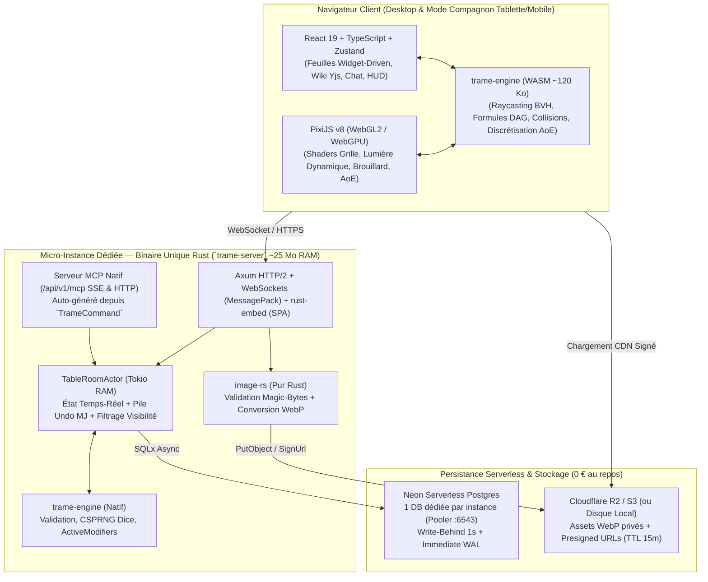

# TRAME — Tabletop Rules, Actors, Maps & Encounters

> **Architecture Clean-Slate & Hébergement Dédié (ex-CozyVTT v2)**  
> Licence cible : **Apache-2.0** | Dépôt cible : `Hartorn-Inc/trame`

Ce dossier regroupe l'intégralité des spécifications architecturales et fonctionnelles de **TRAME**, issues de l'analyse critique de CozyVTT v1 et affinées lors des sessions de conception détaillée et de stress-test (`/grill-with-specs` — 25 décisions d'architecture validées).

---

## Index des Documents de Spécification (`V2/`)

| Fichier | Périmètre couvert |
| :--- | :--- |
| [**`01-TABLE-SPEC.md`**](./01-TABLE-SPEC.md) | **La Table Virtuelle (Cœur GPU PixiJS v8 + Géométrie WASM)** : Modes Exploration vs Combat Tour-par-Tour, Empreintes multi-cases ($0.5 \times 0.5$ à $4 \times 4$) & Squeezing, Élévation 3D (axe Z & vol), Interruptions & Réactions d'Opportunité, Murs/Portes/Fenêtres/Toits, Cycle Jour/Nuit & Intérieur/Extérieur, Téléporteurs & Multi-cartes simultanées, Capteurs de Vision (`Darkvision`, `See Invisibility`, `Truesight`, `Ethereal`), 3 couches de Brouillard, Gabarits AoE avec 4 règles de discrétisation et Zones Persistantes, Dessins à main levée & Audio spatialisé, Outils de Correction/Undo MJ. |
| [**`02-GAME-ENGINE-AND-DND5E.md`**](./02-GAME-ENGINE-AND-DND5E.md) | **Moteur de Système de Jeu Générique (`GameSystemPack`) & Pack Built-in D&D 5e** : Schéma déclaratif YAML/JSON (`character`, `npc`, `companion/summon` avec *Wild Shape*, `container/group_stash`), Graphe DAG de formules dérivées, Pipeline déterministe en 5 phases des `ActiveModifiers` (Objets, Dons, Capacités, Conditions), Gestion des durées par tour & Concentration automatique, Types de dégâts/résistances/immunités & 3 modes de transparence de combat (Réglage de campagne), Couche Homebrew & Compendium SRD, Bibliothèque de ~15 Widgets JDR & Assistant de Création/Level-Up. |
| [**`03-MCP-AND-NOTES-SPEC.md`**](./03-MCP-AND-NOTES-SPEC.md) | **Serveur MCP Natif, Système de Notes Wiki & Skills Externes** : Parité 100% UI $\leftrightarrow$ MCP via le bus `TrameCommand`, Mode *Dry-Run / Staging Proposal* et Batching Atomique annulable en 1 clic, Wiki Markdown à 3 niveaux (`PRIVATE`, `PARTY`, `DM_ONLY`) avec blocs secrets `:::dm` et révélation `:::handout`, Édition collaborative temps-réel CRDT (`yrs` / Yjs) + fusion 3-voies (`diffy`) pour synchronisation bidirectionnelle Obsidian / Notion, Journal structuré d'événements de session (`Session Event Stream`). |
| [**`04-RUNTIME-AND-DEDICATED-HOSTING.md`**](./04-RUNTIME-AND-DEDICATED-HOSTING.md) | **Architecture Temps-Réel (Command Handler, Acteurs RAM) & Hébergement Dédié** : Pattern `CommandHandler` + `ReversiblePatch` (Undo/Redo MJ), Acteur `TableRoomActor` en RAM avec double persistance (*Write-Behind 1s* + *Immediate Commit WAL*), Générateur de dés cryptographique côté serveur (`ChaCha20Rng`), Sécurité des images R2/S3 par URLs pré-signées et conversion WebP en pur Rust (`image-rs`), Archive portable `.trame`, Modèle d'hébergement dédié à la demande (Cloud Run + Neon Postgres + Cloudflare R2 à 0 € grâce à l'`Idle-Lease`, ou VM `e2-micro`), Mode Compagnon Mobile/Tablette & Accessibilité. |

---

## Synthèse de la Stack Technologique Retenue

---

## Gouvernance EPURE Prévue pour `Hartorn-Inc/trame` (Q24)

Lors de l'initialisation du dépôt `Hartorn-Inc/trame` avec `/setup-repo`, le roster de **12 agents reviewers spécialisés** (`.cursor/agents/*.md`) sera configuré pour couvrir l'ensemble de l'architecture Rust + WASM + PixiJS + MCP :

### 5 Spécialistes de Domaine & Stack (`paths`-scoped)
1. **`engine-wasm-reviewer`** (`crates/trame-engine/**`) : Déterminisme Rust/WASM, absence de panics/allocations inutiles à 60 FPS, exactitude du BVH spatial, du raycasting 2D/3D et du pipeline de règles en 5 phases.
2. **`table-gpu-reviewer`** (`packages/web/src/table/**`) : Shaders PixiJS v8 (WebGL2/WebGPU), gestion de la mémoire GPU (FBO brouillard/lumière), fluidité 60 FPS, règles AoE et synchronisation des animations.
3. **`domain-server-reviewer`** (`crates/trame-server/**`) : Pattern `CommandHandler`, `TableRoomActor`, garantie zéro-perte WAL/Write-Behind, sécurité MCP (`Scoped PAT`), conversion `image-rs` et `Idle-Lease` WebSocket.
4. **`game-systems-reviewer`** (`packages/game-systems/**`, `crates/trame-engine/src/systems/**`) : Conformité du schéma `GameSystemPack`, exactitude des règles D&D 5e (SRD 5.1 CC-BY-4.0), widgets de feuilles et empilement des dons/effets.
5. **`infra-reviewer`** (`deploy/**`, `.github/**`, `Cargo.toml`, `Dockerfile`) : Image Docker `distroless`, configuration Cloud Run / `e2-micro`, Neon Postgres, Cloudflare R2 et sécurité CI/CD.

### 7 Reviewers Transversaux Always-On
6. **`architecture-reviewer`** : Respect de la parité 100% UI $\leftrightarrow$ MCP (`TrameCommand`) et absence de duplication entre client et serveur.
7. **`security-reviewer`** : Filtrage réseau Zero-Trust par token (anti-triche vision, canaux `INVISIBLE`/`ETHEREAL`/`HIDDEN_BY_DM`), purge serveur des blocs `:::dm`, CSPRNG dés, et URLs pré-signées R2.
8. **`spec-parity-reviewer`** : Conformité 1-pour-1 avec les 4 spécifications de référence (`01` à `04`).
9. **`standards-reviewer`** : Qualité idiomatique Rust (`clippy --all-targets -- -D warnings`) et TypeScript strict (zéro `any`), tests paramétrés.
10. **`frontend-reviewer`** : Architecture React 19, séparation Zustand / TanStack Query / Yjs CRDT, et Mode Compagnon Mobile.
11. **`accessibility-reviewer`** : WCAG 2.2 AA, navigation clavier, contrastes des thèmes (`-ink`) et mode daltonien sur la Table.
12. **`design-reviewer` & `user-advocate`** : Expérience des 4 personas (*MJ*, *Joueur*, *Spectateur*, *Opérateur d'Instance*) en modes Exploration et Tour-par-Tour.
