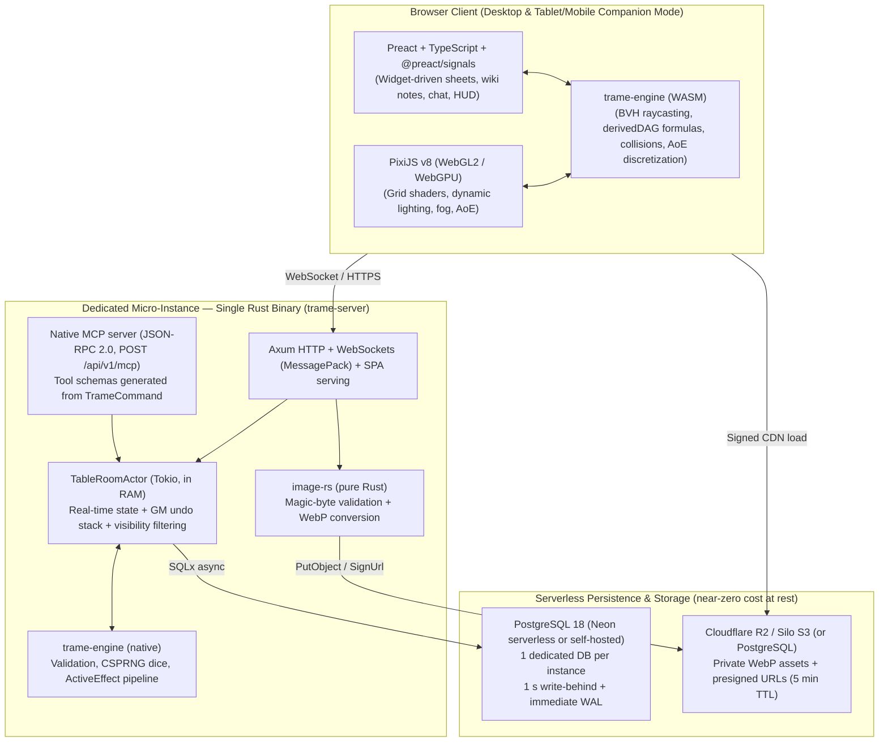

# TRAME — Tabletop Rules, Actors, Maps & Encounters

> **Clean-Slate Architecture & Dedicated Hosting (formerly CozyVTT v2)**  
> Target license: **Apache-2.0** | Repository: `Hartorn-Inc/trame`

This document is the entry point to the architectural and functional specifications of **TRAME**. They come from a critical review of CozyVTT v1 and were refined through detailed design sessions and stress tests (`/grill-with-specs`, 25 validated architecture decisions). Domain terms are defined in [`GLOSSARY.md`](./GLOSSARY.md).

---

## Specification Index (`docs/specs/`)

| File | Scope |
| :--- | :--- |
| [**`01-TABLE-SPEC.md`**](./docs/specs/01-TABLE-SPEC.md) | **The Virtual Table (PixiJS v8 GPU core + WASM geometry)**: Exploration vs Turn-by-Turn modes, multi-cell footprints ($0.5 \times 0.5$ to $4 \times 4$) and squeezing, 3D elevation (Z axis and flight), interruptions and opportunity reactions (`ReactionPrompt`), walls/doors/windows/roofs, day/night cycle and indoor/outdoor, teleporters and simultaneous multi-maps, vision senses (`Darkvision`, `See Invisibility`, `Truesight`, `Ethereal`), 3 fog layers, AoE templates with 4 discretization rules and persistent zones, freehand drawings and spatial audio, GM correction tools and undo (`UndoEntry`). |
| [**`02-GAME-ENGINE-AND-DND5E.md`**](./docs/specs/02-GAME-ENGINE-AND-DND5E.md) | **Generic game system engine (`GameSystemPack`) & built-in D&D 5e pack**: declarative JSON schema (`character`, `npc`, `companion/summon` with *Wild Shape*, `container/group_stash`), derived-formula DAG (`derivedDAG`, evaluated by the single WASM evaluator), deterministic 5-phase `ActiveEffect` pipeline (`Base -> Add -> Multiply -> Override -> ClampMin/ClampMax`) for items, feats, features and conditions, per-turn durations and automatic concentration, damage types/resistances/immunities and 3 combat transparency modes (campaign setting), homebrew layer and SRD compendium, sheet widget library, and creation/level-up wizards. |
| [**`03-MCP-AND-NOTES-SPEC.md`**](./docs/specs/03-MCP-AND-NOTES-SPEC.md) | **Native MCP server, wiki notes & external skills**: 100% UI $\leftrightarrow$ MCP parity through the `TrameCommand` bus, *Staging Proposal* mode (`McpStagingProposal`) and atomic batches undoable in 1 click, 3-tier Markdown wiki (`PRIVATE`, `PARTY`, `DM_ONLY`) with secret `:::dm` blocks and `:::handout` reveals, `LineAnchorNoteMerge` for player edits on `PARTY` notes, and the structured session event stream (`SessionTimelineEvent`). |
| [**`04-RUNTIME-AND-DEDICATED-HOSTING.md`**](./docs/specs/04-RUNTIME-AND-DEDICATED-HOSTING.md) | **Real-time architecture (command handler, in-RAM actors) & dedicated hosting**: `TrameCommand` handler with a snapshot-based 50-entry `UndoEntry` ring buffer (GM undo), in-RAM `TableRoomActor` with dual persistence (*1 s write-behind* + *immediate WAL commit*), server-side cryptographic dice (`ChaCha20Rng`), R2/S3 image security through presigned URLs and pure-Rust WebP conversion (`image-rs`), portable `.trame` archive, on-demand dedicated hosting model (Cloud Run + Neon Postgres + Cloudflare R2 at near-zero idle cost thanks to the `Idle-Lease`, or an `e2-micro` VM), mobile/tablet companion mode and accessibility. |

Feature specifications (`e1`-`e5`, `spec-*`) live next to these four documents in [`docs/specs/`](./docs/specs/). The current whole-application spec is [`spec-internet-ready-playable-trame.md`](./docs/specs/spec-internet-ready-playable-trame.md) (v4: invite-only access, crash-safe WAL recovery, full SRD 5.2.1 play, free hosting). It builds on the delivered convergence baseline [`spec-playable-dnd5e-campaign-convergence.md`](./docs/specs/spec-playable-dnd5e-campaign-convergence.md) (v3).

## Operator Guides (`deploy/`)

| File | Scope |
| :--- | :--- |
| [`deploy/compose/README.md`](./deploy/compose/README.md) | Strictly-free hosting target: production Docker Compose stack behind Caddy (automatic HTTPS) on an Oracle Cloud Always Free VM or a home machine behind Cloudflare Tunnel, optional Silo, nightly backups (ADR-0041). |
| [`deploy/terraform/README.md`](./deploy/terraform/README.md) | Near-free hosting target: Cloud Run `europe-west9` + Neon + Cloudflare R2 with Terraform, keyless GitHub Actions deploys, and the budget spending cap (warnings at 1 and 5 EUR, billing unlinked at 10 EUR) (ADR-0041). |
| [`deploy/backup-and-restore.md`](./deploy/backup-and-restore.md) | Backup and restore runbook for both targets: schedule, retention, restore, restore drills, and asset bucket protection. |

The server configuration (every environment variable, default and requirement) is listed in [`README.md`](./README.md#server-configuration).

---

## Technology Stack Summary

---

## Architecture Decision Records (`docs/adr/`)

| ADR | Topic |
| :--- | :--- |
| [0001](./docs/adr/0001-dnd5e-gamesystempack-pipeline-and-compendium.md) | D&D 5e `GameSystemPack` pipeline and compendium (amended: single WASM formula evaluator; Decision 6 superseded by ADR-0037) |
| [0002](./docs/adr/0002-asset-store-and-uvtt-import-pipeline.md) | Asset store and UVTT import pipeline |
| [0003](./docs/adr/0003-interactive-table-hud-and-decoupled-canvas-overlays.md) | Interactive table HUD and decoupled canvas overlays |
| [0004](./docs/adr/0004-crdt-secret-isolation-handout-lifecycle.md) | Secret isolation and handout lifecycle |
| [0005](./docs/adr/0005-cloud-run-scale-to-zero-and-sigterm-hibernation.md) | Cloud Run scale-to-zero and SIGTERM hibernation |
| [0006](./docs/adr/0006-declarative-character-sheet-ui-architecture.md) | Declarative character sheet UI |
| [0007](./docs/adr/0007-client-side-character-builder-and-drag-drop.md) | Client-side character builder and drag-and-drop |
| [0008](./docs/adr/0008-portable-trame-campaign-archive-format.md) | Portable `.trame` campaign archive |
| [0009](./docs/adr/0009-mobile-companion-and-session-timeline.md) | Mobile companion and session timeline |
| [0010](./docs/adr/0010-hybrid-auth-preact-signals-and-postgres-runtime.md) | Hybrid auth, Preact signals, and Postgres runtime (amended by ADR-0039 and ADR-0041) |
| [0011](./docs/adr/0011-atlas-design-system-and-impeccable-gate.md) | ATLAS design system and impeccable gate |
| [0012](./docs/adr/0012-dnd5e-levelup-rest-architecture.md) | D&D 5e level-up and rests — **superseded by ADR-0036** |
| [0034](./docs/adr/0034-campaign-map-scene-persistence-and-table-activation.md) | Campaign map scene persistence and `ActivateScene` |
| [0035](./docs/adr/0035-scene-atlas-zero-trust-rbac-and-secret-masking.md) | `SceneAtlas` zero-trust RBAC and secret masking |
| [0036](./docs/adr/0036-dnd5e-levelup-rest-architecture.md) | D&D 5e level-up and rests (supersedes ADR-0012; Decision 3 superseded by ADR-0037) |
| [0037](./docs/adr/0037-actor-rest-vs-token-trame-command-boundary.md) | REST `Actor` sheet boundary vs tactical `TrameCommand` state |
| [0038](./docs/adr/0038-srd-521-rules-baseline.md) | SRD 5.2.1 rules baseline for the built-in D&D 5e pack (amends ADR-0001) |
| [0039](./docs/adr/0039-invite-only-registration-and-instance-role.md) | Invite-only registration and `InstanceRole` (amends ADR-0010 Decision 1) |
| [0040](./docs/adr/0040-wal-recovery-with-quarantine.md) | WAL recovery with `QuarantinedWalEntry` quarantine |
| [0041](./docs/adr/0041-s3-asset-storage-signed-downloads-and-free-hosting.md) | S3-compatible asset storage, signed direct downloads, and free hosting targets (amends ADR-0010) |
| [0042](./docs/adr/0042-server-held-pending-resolutions.md) | Server-held `PendingResolution` for attacks, area saves, and concentration checks |

**Numbering gap (0013-0033):** this repository has no ADRs numbered 0013 to 0033, and none are missing. Those numbers belong to the upstream EPURE governance framework (`Giskard-AI/epure`): references such as `ADR-0017`, `ADR-0023` or `ADR-0031` in `.github/`, `.agents/skills/`, or spec compliance lines point to EPURE ADRs, not to `docs/adr/`. Local ADRs resumed at 0034 to avoid colliding with those upstream numbers. ADR-0036 restates ADR-0012 under a non-colliding number for the same reason.

---

## EPURE Governance for `Hartorn-Inc/trame`

The repository is configured with `/setup-repo`. Its canonical 14-agent roster lives in `.cursor/agents/*.md` (`model: inherit`, see [`AGENTS.md`](./AGENTS.md)) alongside user-level plumbing and escalation agents (`stack-operator`, `test-runner`, `senior-architect`):

### Lane Builders (3)
1. **`rust-builder`**: Rust spatial/rules engine (`crates/trame-engine`, WASM parity), Axum server (`crates/trame-server`), and SQL migrations; verified via `make lint-rust`, `make test-rust`, and `make wasm`.
2. **`web-builder`**: Preact + PixiJS v8 web client (`packages/web`), SRD 5.2.1 `GameSystemPack` and pack generator (`packages/game-systems/dnd5e`, `scripts/open5e*.ts`), and Playwright E2E journeys (`e2e/`); verified via `make lint-web`, `make lint-design`, `make test-game-systems`, and `make test-web`.
3. **`infra-builder`**: Docker/Compose stacks, Caddy, Silo, Cloud Run Terraform (`deploy/`), `Makefile`, CI workflows (`.github/workflows/`), and operational scripts; verified via `make lint-terraform`, `make test-budget-cap`, and `make deploy-compose-smoke`.

### Read-Only Reviewers (11)
4. **`architecture-reviewer`**: crate and package boundaries, deep-module interfaces, ADR compliance, 100% UI $\leftrightarrow$ MCP parity, and ubiquitous `GLOSSARY.md` vocabulary.
5. **`domain-backend-reviewer`**: spatial engine geometry, `TrameCommand` state transitions, WebSocket transport, `TableRoomActor` `Idle-Lease` and WAL/quarantine persistence, MCP tool parity and `McpStagingProposal` RBAC, CRDT/note synchronization, and SQLx/S3 storage (consolidating spatial, WAL, MCP, and real-time review).
6. **`game-systems-reviewer`**: `GameSystemPack` schema compliance, SRD 5.2.1 rules accuracy (CC-BY-4.0), deterministic 5-phase `ActiveEffect` evaluation, L1–20 progression, and `SrdPack` determinism.
7. **`frontend-reviewer`**: Preact component architecture, `PreactSignalState` boundaries, `WidgetRegistry` discipline, PixiJS v8 `SceneGraph`, and `MobileCompanionView`.
8. **`design-reviewer`**: `DESIGN.md` (ATLAS v1.1) design tokens, `CanvasThemePalette` boundaries, responsive layout integrity, and interaction states.
9. **`accessibility-reviewer`**: WCAG 2.2 AA dual-theme contrast, keyboard navigation, ARIA semantics, non-color tactical redundancy, and `en`/`fr` UI parity.
10. **`security-reviewer`**: Argon2id/CSPRNG authentication, per-recipient RBAC and fog-of-war stripping (`VisibilityChannel`, `:::dm` and unrevealed `:::handout` purge), UVTT upload guards, presigned asset URLs, and CI/ops secret hygiene.
11. **`infra-reviewer`**: CI/CD workflows, Docker/Compose definitions, Terraform modules, `Makefile` targets, and runtime configuration.
12. **`spec-parity-reviewer`**: strict 1-to-1 acceptance parity between the approved specification or GitHub Issue and the diff and tests.
13. **`standards-reviewer`**: English-only language policy, architectural module banners, idiomatic Rust (`cargo clippy -- -D warnings`), strict TypeScript, and parametrized tests.
14. **`user-advocate`**: persona UX gate (`design-gate` and `implementation-review`) for the Game Master, Player, Spectator, and Instance Operator across Exploration and Turn-by-Turn modes.
