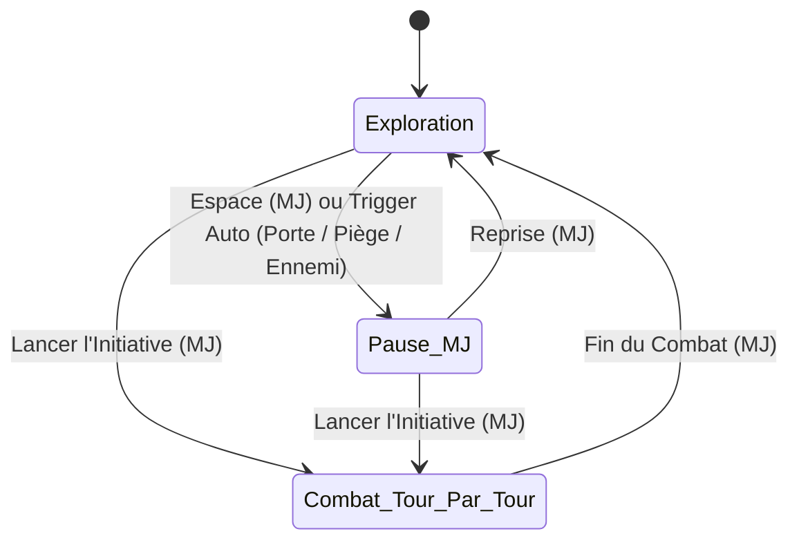

# TRAME — Phase 1 : Spécification de la Table & des Actions en Jeu

Ce document détaille le fonctionnement exhaustif de la **Table Virtuelle** de **TRAME** (*Tabletop Rules, Actors, Maps & Encounters*), propulsée par **PixiJS v8 (WebGL2/WebGPU)** côté rendu et par **`trame-engine` (Rust / WASM)** côté géométrie, physique et visibilité.

---

## 1. Les Deux Modes de Jeu de la Table : Exploration vs Tour-par-Tour

La Table possède une machine à états explicite contrôlée par le MJ avec **deux modes de jeu** distincts (plus un état transversal **Pause MJ** activable avec `Espace`).

### 1.1 Mode Exploration (Hors Combat)

* **Déplacement Direct + Waypoints** :
  * Le joueur glisse son token librement sur la grille (avec `Espace` ou clic droit pendant le glisser pour poser des points de passage et contourner les coins).
  * **Collision stricte** : Le trajet est bloqué par les murs et les portes fermées (le MJ peut ignorer les collisions en maintenant `Alt`).
  * **Anti-scout au survol** : Le masque de vision/lumière du joueur n'est recalculé qu'au **relâchement** du token sur sa case d'arrivée, empêchant de balayer une pièce sombre avec son curseur sans s'y déplacer.
* **Contrôle du rythme réglable par le MJ** :
  * **Pause globale (`Espace`)** : Figer instantanément tous les mouvements des joueurs avec un bandeau *"Jeu en pause par le MJ"*.
  * **Triggers d'arrêt automatiques (configurables par le MJ)** :
    * *Pause à l'ouverture d'une porte* (`on/off`) : Dès qu'un joueur ouvre une porte fermée, son mouvement s'arrête et la Table peut optionnellement se mettre en pause pour laisser le MJ décrire la salle.
    * *Pause à la détection d'un ennemi* (`on/off`) : Si le déplacement d'un joueur fait entrer un token hostile dans son champ de vision, le mouvement du joueur s'interrompt sur cette case.
    * *Zones de déclenchement MJ (Trap / Event Triggers)* : Polygones invisibles dessinés par le MJ qui stoppent le token entrant et notifient le MJ (ex: dalle piégée, embuscade).

### 1.2 Mode Tour-par-Tour (Combat avec Initiative)

Dès que le MJ bascule en mode **Combat / Initiative**, les règles de la Table deviennent tactiques (style *Baldur's Gate 3*) :

* **Verrouillage de tour** : Seul le joueur contrôlant le token actif dans l'ordre d'initiative peut déplacer son token (le MJ peut toujours tout déplacer ou autoriser un déplacement hors-tour/réaction).
* **Déplacement Planifié avec Budget de Vitesse** :
  * Cliquer/déplacer depuis son token ne le bouge pas immédiatement : cela trace une **trajectoire prévisualisée** case par case (en prenant en compte les diagonales du système de jeu et les zones de **terrain difficile** qui coûtent double, ex: `10 ft` au lieu de `5 ft`).
  * **Code couleur de la trajectoire** :
    * **Vert** : Dans le budget de mouvement restant du tour (ex: `0 → 30 ft`).
    * **Jaune (Dash / Foncer)** : Nécessite de consommer une Action pour doubler son mouvement (`35 → 60 ft`).
    * **Rouge** : Au-delà de la capacité maximale du tour.
  * **Validation** : Le joueur clique sur *"Confirmer le déplacement"* (ou double-clic / `Entrée`). Le token se déplace alors le long du chemin, déduit la distance parcourue de sa jauge de mouvement (`ex: 15 / 30 ft restants`), et met à jour sa vision.
* **Suivi de l'Économie d'Action par Tour** :
  * Autour du token actif (et dans le HUD de combat), le moteur affiche le budget du tour défini par le `GameSystemPack` (pour D&D 5e : **Mouvement**, **Action** ●, **Action Bonus** ◆, **Réaction** ↺).
  * Lancer un sort d'1 Action ou une Attaque coche automatiquement la pastille correspondante (avec possibilité pour le joueur ou le MJ de la cocher/décocher manuellement). Au début du tour suivant du personnage, son mouvement et ses pastilles (y compris sa Réaction) sont réinitialisés.

### 1.3 Empreinte multi-cases, Occupation & Empilement de Tokens (Q1)

* **Empreinte sur la grille (`Footprint`)** :
  * *Tiny (TP)* : $0.5 \times 0.5$ case (jusqu'à 4 créatures Tiny par case).
  * *Small (P) / Medium (M)* : $1 \times 1$ case.
  * *Large (G)* : $2 \times 2$ cases (4 cases).
  * *Huge (TG)* : $3 \times 3$ cases (9 cases).
  * *Gargantuan (Gig)* : $4 \times 4$ cases ou plus.
  * En **Mode Exploration (ou combat) pour les Tokens > $1 \times 1$** : un token *Large* ($2 \times 2$) peut passer dans un couloir d'1 case de large via la règle d'**Étroitesse (`Squeezing`)**, ce qui coûte automatiquement `2x` en mouvement (comme du terrain difficile) et signale l'état *Squeezing* sur le token.
* **Traversée et Arrêt sur une Case Occupée** :
  * Un token peut **traverser** les cases d'un allié (coût de terrain difficile `2x` en mode Combat), mais **ne peut pas terminer son déplacement** sur une case déjà occupée par une autre créature vivante (la case finale est marquée en rouge).
  * **Corps au sol / Créatures à $0\text{ PV}$ (`Prone / Dead Stack`)** : Lorsqu'un token tombe à $0\text{ PV}$ ou est marqué *Mort/Inconscient*, il bascule automatiquement dans la sous-couche **Au Sol (`Corpse/Prone Sub-Layer`)**. Un token vivant peut alors se déplacer et s'arrêter sur cette case : une icône de pile (*Stack Badge*) en coin de case permet au MJ ou aux joueurs de sélectionner ou fouiller le corps sous le token actif.

### 1.4 Élévation (Axe Z), Vol & Portée 3D (Q2)

* Chaque token, mur de terrain et source lumineuse possède une propriété d'altitude **`elevation_ft`** (par défaut `0 ft`, modifiable avec `Alt + Molette` ou saisie directe, affichée sous forme de badge `+20 ft` avec ombre portée décalée sur le sol).
* **Calcul de Distance et Portée 3D (`trame-engine`)** :
  * La distance vers une cible volante ou en hauteur est calculée en 3D selon la règle de campagne choisie :
    * *Mode Standard 5e (Chebyshev 3D)* : $\max(\Delta X, \Delta Y, \Delta Z)$.
    * *Mode Tactique / Diagonales 5-10-5 ou Euclidien 3D* : $\sqrt{\Delta X^2 + \Delta Y^2 + \Delta Z^2}$ arrondi à la case.
* **Occlusion 3D des Murs et Toits** :
  * Chaque segment de mur et polygone de toit possède une hauteur (`bottom_z`, `top_z`, par défaut `0 -> +∞` pour un donjon souterrain, ou `0 -> 15 ft` pour un mur d'enceinte / toit de maison).
  * Un token volant à `+30 ft` voit par-dessus un mur de `15 ft` et peut survoler un toit sans être bloqué.

### 1.5 Interruptions de Mouvement & Réactions en Temps-Réel (Q3)

Lorsqu'un token valide un déplacement en mode Tour-par-Tour, il glisse case par case le long de sa trajectoire :
* **Détection automatique d'Attaque d'Opportunité (AoO)** : Si la trajectoire quitte la zone d'allonge (`reach`, `5 ft` ou `10 ft`) d'un ennemi visible et que le token ne possède pas l'état *Désengagement (`Disengage`)*, le moteur met le déplacement en **Pause d'Interruption** sur la case de sortie et affiche une alerte (`⚡ Opportunité d'Attaque / Réaction`) au MJ et au joueur concerné.
* **Bouton d'Interruption Manuelle ("⚡ Demander Réaction")** : À tout moment pendant le tour d'un adversaire (sort lancé, attaque déclarée, mouvement), un joueur disposant encore de sa pastille **Réaction ↺** peut cliquer sur **⚡ Réaction** (*Bouclier*, *Contresort*, * Action préparée*), ce qui suspend brièvement la résolution pour permettre au MJ de valider ou d'ignorer l'interruption.

---

## 2. Géométrie, Murs, Portes, Calques Verticaux & Cycle Jour/Nuit

### 2.1 Les 5 Types de Segments Vectoriels (Indexés en BVH dans `trame-engine`)

| Type de segment | Mouvement | Vision & Lumière | Zones d'Effet (AoE) | Interaction Joueur |
| :--- | :--- | :--- | :--- | :--- |
| **1. Mur Plein** | Bloqué (sauf si `elevation > top_z`) | Bloqué | Bloque l'explosion | Aucune |
| **2. Fenêtre / Grille** | Bloqué | Laisse passer vision & lumière | Bloque (vitre) ou Laisse passer (grille) | Ouvrable si déverrouillée |
| **3. Mur de Terrain / Falaise** | Bloqué (ou escalade `2x`) | Visible de l'extérieur (1er mur ignoré), bloque tout ce qui est derrière | Bloque derrière | Aucune |
| **4. Porte** (`Ouverte`, `Fermée`, `Verrouillée`, `Secrète`) | Bloqué si fermée/verrouillée | Bloqué si fermée | Bloque si fermée | Clic pour Ouvrir/Fermer si le token du joueur est à $\le 1$ case. Si verrouillée : son + message *"Verrouillée"*. Si secrète : invisible pour le joueur (rendue comme un mur normal). |
| **5. Rideau / Illusion** | Libre (franchissable) | Bloqué | Laisse passer | Franchissable à pied |

### 2.2 Calque des Toits / Façades (`Overhead / Roof Layer`)

* Le MJ peut placer des tuiles d'images (toits d'auberges, cimes d'arbres, ponts) sur le calque **Toits (`Overhead`)** avec un polygone d'occultation automatique et une altitude `top_z`.
* Tant que le token d'un joueur est à l'extérieur du bâtiment (et en dessous de `top_z`), il voit le toit et les murs extérieurs bloquent sa vue.
* Dès que le token franchit la porte ou entre sous le polygone du bâtiment, le toit s'estompe en fondu (`alpha: 0.15` ou `0.0`) pour ce joueur, dévoilant l'intérieur de la pièce.

### 2.3 Cycle Jour / Nuit & Éclairage Ambiant par Défaut

* **Comportement par défaut (si non précisé par le MJ)** :
  * Une nouvelle carte démarre en **Plein Jour (`Day` — Illumination Globale active, niveau `1.0 / Bright`)** : tant qu'aucun mur ne bloque la ligne de vue d'un token, celui-ci voit clairement toute la zone ouverte sans avoir besoin de torche ni de vision dans le noir.
* **Sélecteur Rapide de Cycle Jour / Nuit (1 clic dans le HUD MJ)** :
  * **Jour (`Day`)** : Lumière vive globale (`1.0`) + teinte naturelle.
  * **Aube / Crépuscule (`Dawn / Dusk`)** : Lumière faible globale (`0.5 / Dim`) + teinte ambrée/orangée.
  * **Nuit Étoilée / Clair de Lune (`Moonlight`)** : Lumière faible globale (`0.5`) + teinte bleutée nocturne à l'extérieur des bâtiments.
  * **Nuit Noire / Donjon Souterrain (`Pitch Dark / Dungeon`)** : Illumination globale désactivée (`0.0 / Darkness`).
* **Zonage Extérieur vs Intérieur (`Indoor Polygons`)** :
  * Un bâtiment (ou une zone sous un toit `Overhead`) marqué **`Indoor`** reste dans l'obscurité même s'il fait **Plein Jour** dehors, tant qu'une porte ouverte ou une fenêtre ne laisse pas entrer la lumière extérieure.

### 2.4 Téléporteurs, Escaliers & Transitions Multi-Cartes (Q18)

* Le MJ peut placer des **Régions de Transition (`Stairs / Teleporter Zones`)** sur une carte :
  * **Intra-carte (Multi-étages sur le même canevas)** : Lorsqu'un token marche sur l'escalier du Rez-de-Chaussée, il est automatiquement déplacé vers l'arrivée de l'escalier à l'Étage 1 (avec mise à jour de son `elevation_ft` et recalibrage instantané de la caméra et de la vision).
  * **Inter-cartes (Vers une autre carte préparée)** : Permet de diviser le groupe (*Split Party*) ou de faire descendre un éclaireur au sous-sol : le serveur supporte **plusieurs cartes actives simultanément** au sein d'une même session, chaque joueur voyant la carte sur laquelle se trouve son token principal.

---

## 3. Vision par Token, Canaux de Visibilité & Brouillard de Guerre

### 3.1 Vision Individuelle vs Vision de Groupe (Optionnelle)

1. **Mode Vision Individuelle (Par défaut)** : Chaque joueur ne voit que ce que voient les tokens qu'il contrôle (et s'il sélectionne l'un de ses tokens, ex: son Familier, il voit uniquement à travers les yeux de ce token).
2. **Mode Vision Partagée de Groupe (Optionnel)** : Tous les joueurs voient l'union des polygones de vision de tous les tokens alliés du groupe.

### 3.2 Capteurs de Vision (`SenseModes`) & Canaux de Visibilité (`VisibilityChannels`)

| Canal du Token Cible | Qui peut le voir (Filtrage Serveur + Rendu Client) ? | Rendu Visuel sur la Table |
| :--- | :--- | :--- |
| **`MATERIAL` (Normal)** | Tout token ayant une ligne de vue (`LoS`) éclairée, ou possédant `Darkvision` / `Blindsight` / `Truesight` à portée. | Couleurs normales en lumière vive ; légèrement assombri en lumière faible ; **monochrome désaturé** si vu uniquement grâce à la *Vision dans le noir (`Darkvision`)*. |
| **`INVISIBLE`** | Le MJ + tout token possédant le capteur `see_invisibility`, `blindsight`, `tremorsense` ou `truesight` à portée et en ligne de vue. | Aura translucide / contour irisé indiquant que la créature est invisible pour le reste du monde. |
| **`ETHEREAL` / `ASTRAL`** | Le MJ + tout token étant lui-même sur le canal `ETHEREAL` ou possédant `truesight` / `see_ethereal`. | Rendu spectral bleuté ; un token en mode `ETHEREAL` ignore les murs matériels non-magiques et voit le plan matériel en grisé vaporeux. |
| **`HIDDEN_BY_DM` (Furtif / Caché MJ)** | Uniquement le MJ (tant que le MJ ne le révèle pas ou qu'un test de Perception ne réussit pas). | Semi-transparent sur l'écran du MJ ; strictement absent des paquets réseau envoyés aux joueurs. |

### 3.3 Les 3 Couches de Brouillard de Guerre

1. **Inexploré (Noir total)** : Zones jamais vues par le joueur.
2. **Mémoire d'Exploration par Joueur (`Explored Memory FBO`)** : Zones déjà visitées par le joueur mais hors de sa ligne de vue actuelle, affichées en grisé/sépia sombre (ne montre que le décor statique, **jamais les tokens**).
3. **Brouillard Manuel du MJ** : Surcouche prioritaire permettant au MJ de révéler ou masquer manuellement une zone au pinceau ou au lasso.

---

## 4. Sorts, Zones d'Effet (AoE) & Terrain Persistant

### 4.1 Les 5 Formes Géométriques AoE & Règles de Discrétisation sur Grille (Q4)

* **Formes** : **Sphère / Cercle**, **Cône**, **Cube**, **Ligne**, **Cylindre / Anneau**.
* **Règle de Discrétisation des Cases Touchées (Réglage de Campagne)** :
  1. **`center_point` (Défaut D&D 5e DMG / XGE)** : Une case de la grille est affectée si et seulement si son point central ($+0.5, +0.5$) est contenu dans le polygone géométrique du gabarit (après découpage par les murs).
  2. **`area_threshold_50`** : Une case est affectée si au moins 50% de sa surface est couverte.
  3. **`any_intersection` (Généreux)** : Toute case effleurée par le gabarit est affectée.
  4. **`grid_template` (Manhattan / Bresenham)** : Gabarit en escalier strictement aligné sur les cases de la grille.

### 4.2 Workflow en 3 Étapes : Prévisualisation $\rightarrow$ Ciblage $\rightarrow$ Résolution ou Persistance

1. **Étape 1 — Prévisualisation Interactive (Fantôme local à 60 FPS)** :
   * Affiche la portée du sort, le gabarit AoE découpé en temps réel contre les murs pleins (via `trame-engine` WASM), les cases de grille affectées et le nombre de cibles touchées.
2. **Étape 2 — Ciblage Assisté & Résolution (Sorts Instantanés)** :
   * Au clic de validation, verrouille les tokens touchés et permet en 1 clic de lancer les jets de sauvegarde groupés et d'appliquer les dégâts (`100%`, `50%`, ou `0%` avec *Dérobade / Evasion*).
3. **Étape 3 — Zones d'Effet Persistantes (Modification Physique de la Table)** :
   * Les zones persistantes restent sur la carte (liées à la **Concentration** du lanceur) et modifient dynamiquement `trame-engine` :
     * **Terrain Difficile (`2x` coût de mouvement)** : *Toile d'araignée*, *Enchevêtrement*, *Graisse*.
     * **Occultation & Lumière** : *Nappe de brouillard* (bloque la vision), *Ténèbres magiques* (bloque vision + `darkvision` standard), *Lumière du jour* (éclaire à `60 ft`).
     * **Déclencheur d'Entrée / Début de Tour (`Zone Hazard`)** : *Esprits gardiens*, *Mur de feu* $\rightarrow$ déclenche une notification de sauvegarde dès qu'un token entre dans la zone ou y débute son tour.

---

## 5. Dessins à Main Levée, Annotations Tactiques & Ambiance Sonore (Q19, Q20)

### 5.1 Calque de Dessin & Annotations (`Freehand & Tactical Drawing Layer`)

* **Outils vectoriels légers** : Crayon à main levée (lissé par courbes de Bézier), Flèche tactique, Rectangle, Cercle et Texte sur la carte.
* **Modes de visibilité du tracé** :
  * **Éphémère (`Ping / Tactique — 10s`)** : Permet à un joueur de dessiner rapidement une flèche *"Je contourne par ici"* qui s'efface toute seule après 10 secondes sans polluer la carte.
  * **Permanent Groupe** : Annotations durables sur la carte (contrôlables et effaçables en 1 clic par le MJ).
  * **Note Visuelle MJ (`DM Layer Only`)** : Croquis ou repères visibles uniquement par le MJ.

### 5.2 Moteur Audio & Soundboard Synchronisé

* **3 Canaux Audio Indépendants (réglables individuellement en volume par chaque joueur)** :
  1. **Musique (`Music`)** : Pistes musicales avec fondu enchaîné (*crossfade* de 2s) lors des changements de scène ou du passage en mode Combat.
  2. **Ambiance & Météo (`Ambience`)** : Boucles sonores continues (pluie, taverne, vent souterrain, crépitement de feu) synchronisées avec les filtres visuels météo de la carte.
  3. **Effets Sonores (`SFX Soundboard`)** : Déclenchés en 1 clic par le MJ ou automatiquement lors d'événements de table (ouverture de porte, porte verrouillée, tonnerre, explosion de *Boule de feu*, critique au dé).
* **Sources Audio Spatialisées sur la Carte (`Positional Audio Sources`)** : Le MJ peut placer un émetteur sonore sur la carte (ex: rivière souterraine, forge, incantation derrière une porte) avec un rayon d'atténuation : le volume augmente au fur et à mesure que le token du joueur s'en approche !

---

## 6. Outils de Correction Rapide MJ ("DM Override & Undo / Redo")

1. **Historique d'Actions & Bouton "Annuler le dernier Mouvement / Action" (`Ctrl+Z` MJ)** :
   * Annuler un déplacement remet le token du joueur à sa case de départ, recrédite son budget de mouvement **et restaure le masque de mémoire d'exploration** d'avant le mouvement erroné.
2. **Déplacement Forcé par le MJ ("Grab & Teleport")** :
   * Le MJ peut déplacer n'importe quel token à tout moment sans consommer le mouvement du joueur et en traversant les murs (`Alt + Drag`).
3. **Correction en 1 Clic de l'Économie d'Action & des Ressources** :
   * Bascule directe des pastilles `Action` ●, `Action Bonus` ◆, `Réaction` ↺, réinitialisation du mouvement (`Reset to 30 ft`) et restauration de PV/emplacements de sorts depuis le journal du tour.
