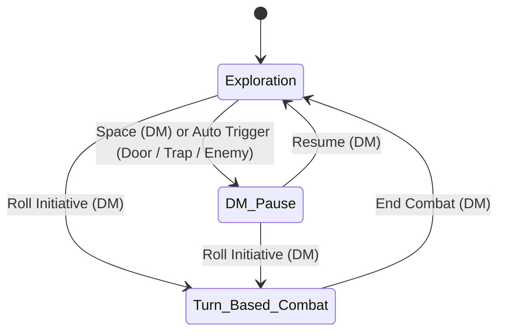

# TRAME — Phase 1: Virtual Table & In-Game Actions Specification

This document details the comprehensive operation of the **Virtual Table** in **TRAME** (*Tabletop Rules, Actors, Maps & Encounters*), powered by **PixiJS v8 (WebGL2/WebGPU)** for rendering and **`trame-engine` (Rust / WASM)** for geometry, physics, and visibility.

---

## 1. The Two Table Game Modes: Exploration vs. Turn-Based

The Table features an explicit state machine controlled by the DM with **two distinct game modes** (plus a cross-cutting **DM Pause** state toggled via `Space`).

### 1.1 Exploration Mode (Out of Combat)

* **Direct Movement + Waypoints**:
  * Players drag their token freely across the grid (pressing `Space` or right-clicking while dragging to drop waypoints and navigate around corners).
  * **Strict Collision**: Movement paths are blocked by walls and closed doors (the DM can bypass collisions by holding `Alt`).
  * **Hover Anti-Scout**: The player's vision/light mask is recalculated only upon **releasing** the token on its destination cell, preventing players from sweeping a dark room with their cursor without actually moving there.
* **DM-Configurable Pacing Controls**:
  * **Global Pause (`Space`)**: Instantly freezes all player movement with a *"Game paused by DM"* banner.
  * **Automatic Stop Triggers (configurable by the DM)**:
    * *Pause on Door Open* (`on/off`): As soon as a player opens a closed door, their movement stops and the Table can optionally pause so the DM can describe the room.
    * *Pause on Enemy Sighting* (`on/off`): If a player's movement brings a hostile token into their field of view, the player's movement halts on that cell.
    * *DM Trigger Zones (Trap / Event Triggers)*: Invisible polygons drawn by the DM that stop an entering token and notify the DM (e.g., pressure plate, ambush).

### 1.2 Turn-Based Mode (Initiative Combat)

As soon as the DM switches to **Combat / Initiative** mode, Table rules become tactical:

* **Turn Locking**: Only the player controlling the active token in the initiative order can move their token (the DM can always move any token or authorize out-of-turn/reaction movement).
* **Planned Movement with Speed Budget**:
  * Clicking and dragging from a token does not move it immediately; instead, it plots a **previewed path** cell by cell (accounting for the game system's diagonal rules and **difficult terrain** zones that cost double, e.g., `10 ft` instead of `5 ft`).
  * **Path Color Coding**:
    * **Green**: Within the remaining movement budget for the turn (e.g., `0 -> 30 ft`).
    * **Yellow (Dash)**: Requires spending an Action to double movement speed (`35 -> 60 ft`).
    * **Red**: Beyond maximum movement capacity for the turn.
  * **Confirmation**: The player clicks *"Confirm Movement"* (or double-clicks / presses `Enter`). The token then moves along the path, deducts the distance traveled from its movement gauge (e.g., `15 / 30 ft remaining`), and updates its vision.
* **Per-Turn Action Economy Tracking**:
  * Around the active token (and in the combat HUD), the engine displays the turn budget defined by the `GameSystemPack` (for D&D 5e: **Movement**, **Action** ●, **Bonus Action** ◆, **Reaction** ↺).
  * Casting a 1-Action spell or making an Attack automatically checks off the corresponding pip (with manual toggle support for the player or DM). At the start of the character's next turn, their movement and action pips (including Reaction) reset.

### 1.3 Multi-Tile Footprint, Occupancy & Token Stacking (Q1)

* **Grid Footprint (`Footprint`)**:
  * *Tiny*: $0.5 \times 0.5$ cell (up to 4 Tiny creatures per cell).
  * *Small / Medium*: $1 \times 1$ cell.
  * *Large*: $2 \times 2$ cells (4 cells).
  * *Huge*: $3 \times 3$ cells (9 cells).
  * *Gargantuan*: $4 \times 4$ cells or larger.
  * In **Exploration (or Combat) Mode for Tokens > $1 \times 1$**: a *Large* ($2 \times 2$) token can pass through a 1-cell-wide corridor via the **Squeezing** rule, which automatically costs `2x` movement (like difficult terrain) and displays the *Squeezing* state on the token.
* **Moving Through and Ending on an Occupied Cell**:
  * A token can **move through** an ally's spaces (`2x` difficult terrain cost in Combat mode), but **cannot end its movement** on a cell already occupied by another living creature (the destination cell is highlighted in red).
  * **Corpses / Creatures at $0\text{ HP}$ (`Prone / Dead Stack`)**: When a token drops to $0\text{ HP}$ or is marked *Dead/Unconscious*, it automatically moves to the **Ground Sub-Layer (`Corpse/Prone Sub-Layer`)**. A living token can then move onto and stop on that cell; a *Stack Badge* icon in the cell corner allows the DM or players to select or loot the body beneath the active token.

### 1.4 Elevation (Z-Axis), Flight & 3D Range (Q2)

* Every token, terrain wall, and light source has an altitude property **`elevation_ft`** (default `0 ft`, adjustable via `Alt + Scroll Wheel` or direct input, displayed as a `+20 ft` badge with an offset drop shadow on the ground).
* **3D Distance and Range Calculation (`trame-engine`)**:
  * Distance to a flying or elevated target is calculated in 3D according to the selected campaign rule:
    * *Standard 5e Mode (3D Chebyshev)*: $\max(\Delta X, \Delta Y, \Delta Z)$.
    * *Tactical / 5-10-5 Diagonals or 3D Euclidean Mode*: $\sqrt{\Delta X^2 + \Delta Y^2 + \Delta Z^2}$ rounded to the nearest cell.
* **3D Occlusion of Walls and Roofs**:
  * Every wall segment and roof polygon has a vertical span (`bottom_z`, `top_z`, defaulting to `0 -> +∞` for an underground dungeon, or `0 -> 15 ft` for a perimeter wall or house roof).
  * A token flying at `+30 ft` sees over a `15 ft` wall and can fly over a roof without being blocked.

### 1.5 Movement Interrupts & Real-Time Reactions (Q3)

When a token confirms movement in Turn-Based mode, it glides cell by cell along its path:
* **Automatic Opportunity Attack (AoO) Detection**: If the path leaves the reach (`5 ft` or `10 ft`) of a visible enemy and the moving token does not have the *Disengage* state, the engine places movement into **Interrupt Pause** on the exit cell and displays an alert (`⚡ Opportunity Attack / Reaction`) to the DM and the relevant player.
* **Manual Interrupt Button ("⚡ Request Reaction")**: At any time during an opponent's turn (spell cast, declared attack, movement), a player who still has their **Reaction ↺** pip can click **⚡ Reaction** (*Shield*, *Counterspell*, *Readied Action*), briefly pausing resolution so the DM can approve or dismiss the interrupt.

---

## 2. Geometry, Walls, Doors, Vertical Layers & Day/Night Cycle

### 2.1 The 5 Vector Segment Types (BVH-Indexed in `trame-engine`)

| Segment Type | Movement | Vision & Light | Areas of Effect (AoE) | Player Interaction |
| :--- | :--- | :--- | :--- | :--- |
| **1. Solid Wall** | Blocked (unless `elevation > top_z`) | Blocked | Blocks blast | None |
| **2. Window / Grate** | Blocked | Allows vision & light through | Blocks (glass) or Allows through (grate) | Openable if unlocked |
| **3. Terrain Wall / Cliff** | Blocked (or `2x` climb) | Visible from outside (1st wall ignored), blocks everything behind it | Blocks behind | None |
| **4. Door** (`Open`, `Closed`, `Locked`, `Secret`) | Blocked if closed/locked | Blocked if closed | Blocks if closed | Click to Open/Close if player token is within $\le 1$ cell. If locked: sound + *"Locked"* message. If secret: invisible to players (rendered as a normal wall). |
| **5. Curtain / Illusion** | Free (passable) | Blocked | Allows through | Passable on foot |

### 2.2 Overhead / Roof Layer (`Overhead / Roof Layer`)

* The DM can place image tiles (inn roofs, tree canopies, bridges) on the **Roofs (`Overhead`)** layer with an automatic occlusion polygon and a `top_z` altitude.
* As long as a player's token is outside the building (and below `top_z`), they see the roof and the exterior walls block their sight.
* As soon as the token steps through the door or enters beneath the building polygon, the roof fades out (`alpha: 0.15` or `0.0`) for that player, revealing the room interior.

### 2.3 Day/Night Cycle & Default Ambient Lighting

* **Default Behavior (when unspecified by the DM)**:
  * A new map starts in **Full Daylight (`Day` — Global Illumination active, level `1.0 / Bright`)**: as long as no wall blocks a token's line of sight, it clearly sees the entire open area without needing a torch or darkvision.
* **Quick Day/Night Cycle Selector (1 click in the DM HUD)**:
  * **Day (`Day`)**: Global bright light (`1.0`) + natural tint.
  * **Dawn / Dusk (`Dawn / Dusk`)**: Global dim light (`0.5 / Dim`) + amber/orange tint.
  * **Starlight / Moonlight (`Moonlight`)**: Global dim light (`0.5`) + nocturnal blue tint outdoors.
  * **Pitch Dark / Underground Dungeon (`Pitch Dark / Dungeon`)**: Global illumination disabled (`0.0 / Darkness`).
* **Outdoor vs. Indoor Zoning (`Indoor Polygons`)**:
  * A building (or area beneath an `Overhead` roof) marked **`Indoor`** remains in darkness even during **Full Daylight** outside, unless an open door or window lets exterior light in.

### 2.4 Teleporters, Stairs & Multi-Map Transitions (Q18)

* The DM can place **Transition Regions (`Stairs / Teleporter Zones`)** on a map:
  * **Intra-Map (Multi-Floor on the Same Canvas)**: When a token steps onto the Ground Floor stairs, it is automatically moved to the Floor 1 stair landing (updating its `elevation_ft` and instantly recalibrating camera and vision).
  * **Inter-Map (To Another Prepared Map)**: Supports splitting the party (*Split Party*) or sending a scout into a basement: the server supports **multiple simultaneously active maps** within a single session, with each player viewing the map where their primary token is located.

---

## 3. Per-Token Vision, Visibility Channels & Fog of War

### 3.1 Individual Vision vs. Party Vision (Optional)

1. **Individual Vision Mode (Default)**: Each player sees only what the tokens they control can see (and if they select one of their specific tokens, e.g., their Familiar, they see exclusively through that token's eyes).
2. **Shared Party Vision Mode (Optional)**: All players see the union of the vision polygons of all allied party tokens.

### 3.2 Vision Sensors (`SenseModes`) & Visibility Channels (`VisibilityChannels`)

| Target Token Channel | Who Can See It (Server Filtering + Client Rendering)? | Visual Rendering on the Table |
| :--- | :--- | :--- |
| **`MATERIAL` (Normal)** | Any token with an illuminated Line of Sight (`LoS`), or possessing `Darkvision` / `Blindsight` / `Truesight` within range. | Full color in bright light; slightly dimmed in dim light; **desaturated monochrome** when seen solely via *Darkvision*. |
| **`INVISIBLE`** | The DM + any token possessing `see_invisibility`, `blindsight`, `tremorsense`, or `truesight` within range and line of sight. | Translucent aura / iridescent outline indicating the creature is invisible to everyone else. |
| **`ETHEREAL` / `ASTRAL`** | The DM + any token itself on the `ETHEREAL` channel or possessing `truesight` / `see_ethereal`. | Bluish spectral rendering; a token in `ETHEREAL` mode ignores non-magical material walls and sees the Material Plane in hazy grayscale. |
| **`HIDDEN_BY_DM` (Stealth / DM Hidden)** | Only the DM (until the DM reveals it or a Perception check succeeds). | Semi-transparent on the DM's screen; strictly omitted from network packets sent to players. |

### 3.3 The 3 Fog of War Layers

1. **Unexplored (Pitch Black)**: Areas never seen by the player.
2. **Per-Player Exploration Memory (`Explored Memory FBO`)**: Areas previously visited by the player but outside their current line of sight, rendered in dark grayscale/sepia (displays static scenery only, **never tokens**).
3. **DM Manual Fog**: High-priority overlay allowing the DM to manually reveal or hide an area using a brush or lasso tool.

---

## 4. Spells, Areas of Effect (AoE) & Persistent Terrain

### 4.1 The 5 Geometric AoE Shapes & Grid Discretization Rules (Q4)

* **Shapes**: **Sphere / Circle**, **Cone**, **Cube**, **Line**, **Cylinder / Ring**.
* **Affected Cell Discretization Rule (Campaign Setting)**:
  1. **`center_point` (D&D 5e DMG / XGE Default)**: A grid cell is affected if and only if its center point ($+0.5, +0.5$) lies inside the template's geometric polygon (after wall clipping).
  2. **`area_threshold_50`**: A cell is affected if at least 50% of its surface area is covered.
  3. **`any_intersection` (Generous)**: Any cell touched by the template is affected.
  4. **`grid_template` (Manhattan / Bresenham)**: Stepped grid template strictly aligned to grid cells.

### 4.2 3-Step Workflow: Preview $\rightarrow$ Targeting $\rightarrow$ Resolution or Persistence

1. **Step 1 — Interactive Preview (Local 60 FPS Ghost)**:
   * Displays spell range, the AoE template clipped in real time against solid walls (via `trame-engine` WASM), affected grid cells, and the number of hit targets.
2. **Step 2 — Assisted Targeting & Resolution (Instantaneous Spells)**:
   * On confirmation click, locks onto hit tokens and enables 1-click grouped saving throws and damage application (`100%`, `50%`, or `0%` with *Evasion*).
3. **Step 3 — Persistent Areas of Effect (Physical Table Modification)**:
   * Persistent zones remain on the map (linked to the caster's **Concentration**) and dynamically modify `trame-engine`:
     * **Difficult Terrain (`2x` movement cost)**: *Web*, *Entangle*, *Grease*.
     * **Obscurement & Light**: *Fog Cloud* (blocks vision), *Darkness* (blocks vision + standard `darkvision`), *Daylight* (illuminates within `60 ft`).
     * **Enter / Start-of-Turn Trigger (`Zone Hazard`)**: *Spirit Guardians*, *Wall of Fire* $\rightarrow$ triggers a saving throw prompt as soon as a token enters the zone or starts its turn there.

---

## 5. Freehand Drawings, Tactical Annotations & Soundscape (Q19, Q20)

### 5.1 Freehand & Tactical Drawing Layer (`Freehand & Tactical Drawing Layer`)

* **Lightweight Vector Tools**: Freehand pencil (Bezier-smoothed), Tactical arrow, Rectangle, Circle, and Map text.
* **Stroke Visibility Modes**:
  * **Ephemeral (`Ping / Tactical — 10s`)**: Allows a player to quickly sketch a *"Flanking this way"* arrow that automatically fades out after 10 seconds without cluttering the map.
  * **Party Permanent**: Durable annotations on the map (controllable and clearable in 1 click by the DM).
  * **DM Visual Note (`DM Layer Only`)**: Sketches or markers visible exclusively to the DM.

### 5.2 Synchronized Audio Engine & Soundboard

* **3 Independent Audio Channels (individually volume-adjustable by each player)**:
  1. **Music (`Music`)**: Musical tracks with a 2s crossfade during scene changes or transitions into Combat mode.
  2. **Ambience & Weather (`Ambience`)**: Continuous sound loops (rain, tavern, underground wind, crackling fire) synchronized with the map's visual weather filters.
  3. **Sound Effects (`SFX Soundboard`)**: Triggered in 1 click by the DM or automatically upon table events (door opening, locked door, thunderclap, *Fireball* explosion, critical hit roll).
* **Spatialized Map Audio Sources (`Positional Audio Sources`)**: The DM can place a sound emitter on the map (e.g., underground river, forge, chanting behind a door) with an attenuation radius: volume increases as the player's token approaches it.

---

## 6. Quick DM Correction Tools ("DM Override & Undo / Redo")

1. **Action History & "Undo Last Movement / Action" Button (`Ctrl+Z` DM)**:
   * Undoing a move returns the player's token to its starting cell, refunds its movement budget, **and restores the exploration memory mask** from before the erroneous move.
2. **DM Forced Movement ("Grab & Teleport")**:
   * The DM can move any token at any time without spending the player's movement budget and while passing through walls (`Alt + Drag`).
3. **1-Click Action Economy & Resource Correction**:
   * Direct toggling of `Action` ●, `Bonus Action` ◆, and `Reaction` ↺ pips, movement reset (`Reset to 30 ft`), and HP/spell slot restoration from the turn log.
