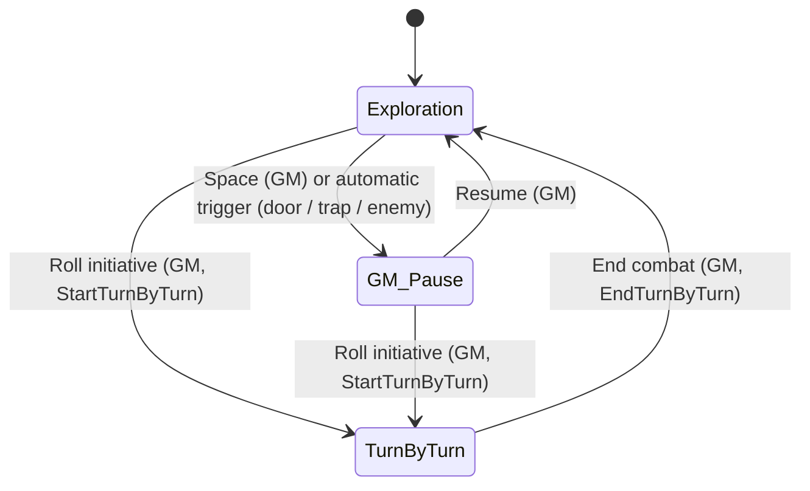

# TRAME — Phase 1: Table & In-Game Actions Specification

This document describes how the **Virtual Table** of **TRAME** (*Tabletop Rules, Actors, Maps & Encounters*) works. Rendering is done by **PixiJS v8 (WebGL2/WebGPU)**; geometry, physics and visibility are computed by **`trame-engine` (Rust, compiled natively for the server and to WebAssembly for the browser)**.

---

## 1. The Two Table Modes: Exploration vs Turn-by-Turn

The table has an explicit state machine controlled by the GM with **two modes** (`TableMode::Exploration` and `TableMode::TurnByTurn`), plus a cross-cutting **GM Pause** state toggled with `Space` (`exploration_paused`).

### 1.1 Exploration Mode (Out of Combat)

* **Direct movement + waypoints**:
  * The player drags their token freely on the grid (pressing `Space` or right-clicking while dragging places waypoints to route around corners).
  * **Strict collision**: walls and closed doors block the path (the GM can ignore collisions by holding `Alt`).
  * **Hover anti-scouting**: the player's vision/light mask is recomputed only when the token is **released** on its destination cell, so a player cannot sweep a dark room with the cursor without moving into it.
* **GM-controlled pacing**:
  * **Global pause (`Space`)**: instantly freezes all player movement and shows a *"Game paused by the GM"* banner.
  * **Automatic stop triggers (configurable by the GM)**:
    * *Pause when a door opens* (`on/off`): as soon as a player opens a closed door, their movement stops and the table can optionally pause so the GM can describe the room.
    * *Pause when an enemy is spotted* (`on/off`): if a player's move brings a hostile token into their field of view, the move stops on that cell.
    * *GM trigger zones (trap / event triggers)*: invisible polygons drawn by the GM that stop the entering token and notify the GM (for example a trapped flagstone or an ambush).

### 1.2 Turn-by-Turn Mode (Combat with Initiative)

When the GM switches to **Turn-by-Turn** mode (`StartTurnByTurn`), the table rules become tactical (in the style of *Baldur's Gate 3*):

* **Turn lock**: only the player controlling the active token in the initiative order can move their token (the GM can always move anything or allow an off-turn move or reaction).
* **Planned movement with a speed budget**:
  * Clicking or dragging from the token does not move it immediately: it draws a **previewed path** cell by cell (taking into account the game system's diagonal rule and **difficult terrain** cells that cost double, for example `10 ft` instead of `5 ft`).
  * **Path color code**:
    * **Green**: within the turn's remaining movement budget (for example `0 → 30 ft`).
    * **Yellow (Dash)**: requires spending an Action to double movement (`35 → 60 ft`).
    * **Red**: beyond the turn's maximum capacity.
  * **Confirmation**: the player clicks *"Confirm move"* (or double-clicks / presses `Enter`). The token then moves along the path, the distance is deducted from its movement budget (`speed_remaining_ft`, for example `15 / 30 ft remaining`), and its vision is updated.
* **Per-turn action economy tracking** (`ActionEconomyType`):
  * Around the active token (and in the combat HUD), the engine shows the turn budget defined by the `GameSystemPack` (for D&D 5e: **Movement**, **Action** ●, **Bonus Action** ◆, **Reaction** ↺).
  * Casting a 1-Action spell or making an Attack automatically ticks the matching pip (the player or GM can tick or untick it manually). At the start of the character's next turn, its movement and pips (including its Reaction) are reset by `AdvanceTurn`.

### 1.3 Multi-Cell Footprints, Occupancy & Token Stacking (Q1)

* **Grid footprint (`Footprint`)**:
  * *Tiny*: $0.5 \times 0.5$ cell (up to 4 Tiny creatures per cell).
  * *Small / Medium*: $1 \times 1$ cell.
  * *Large*: $2 \times 2$ cells (4 cells).
  * *Huge*: $3 \times 3$ cells (9 cells).
  * *Gargantuan*: $4 \times 4$ cells or more.
  * **Tokens larger than $1 \times 1$ (Exploration or combat)**: a *Large* ($2 \times 2$) token can pass through a 1-cell-wide corridor using the **Squeezing** rule (`ToggleSqueeze`), which automatically costs `2x` movement (like difficult terrain) and flags the token as *Squeezing*.
* **Moving through and stopping on an occupied cell**:
  * A token can **move through** an ally's cells (difficult terrain cost `2x` in combat) but **cannot end its move** on a cell already occupied by another living creature (the final cell is marked red).
  * **Bodies on the ground / creatures at 0 HP (`Prone / Dead Stack`)**: when a token drops to 0 HP or is marked *Dead/Unconscious*, it automatically moves to the **Ground sub-layer (`Corpse/Prone Sub-Layer`)**. A living token can then move onto and stop on that cell: a stack badge in the cell corner lets the GM or players select or search the body under the active token.

### 1.4 Elevation (Z Axis), Flight & 3D Range (Q2)

* Every token, terrain wall and light source has an altitude property in feet (`ElevationFt`, `elevation_ft`, default `0 ft`, changed with `Alt + Wheel` or direct input, shown as a `+20 ft` badge with a drop shadow offset on the ground).
* **3D distance and range (`trame-engine`)**:
  * The distance to a flying or elevated target is computed in 3D according to the campaign's `RulerMetric`:
    * *Standard 5e mode (3D Chebyshev, `FiveFiveFive`)*: $\max(\Delta X, \Delta Y, \Delta Z)$.
    * *Tactical mode (5-10-5 diagonals, `FiveTenFive`) or 3D Euclidean (`Euclidean`)*: $\sqrt{\Delta X^2 + \Delta Y^2 + \Delta Z^2}$ rounded to the cell.
* **3D occlusion by walls and roofs**:
  * Every `WallSegment` and roof polygon has a height (`bottom_elevation_ft`, `top_elevation_ft`; by default `0 -> +∞` for an underground dungeon, or `0 -> 15 ft` for a curtain wall or house roof).
  * A token flying at `+30 ft` sees over a `15 ft` wall and can fly over a roof without being blocked.

### 1.5 Movement Interruptions & Reactions (Q3)

When a token confirms a move in Turn-by-Turn mode, it slides cell by cell along its path:
* **Automatic opportunity attack detection (`ThreatReach`)**: if the path leaves the reach (`5 ft` or `10 ft`) of a visible hostile creature and the token does not have the *Disengage* state, `MoveToken` stops the token **on the exit square** and opens a reaction prompt (`ReactionBanner`, `⚡ Opportunity attack / Reaction`) for the **reactor's owner** (the GM for monsters). There is no timer: the owner resolves it with `DecideReaction` (`Trigger` or `Pass`), and the GM can force `Pass` at any time so the table never deadlocks. The move resumes after `Pass` or after the reaction is resolved.
* **Manual reaction button ("⚡ Request reaction")**: at any time during an opponent's turn (spell cast, attack declared, movement), a player who still has their **Reaction ↺** pip can click **⚡ Reaction** (*Shield*, *Counterspell*, *Readied action*), which briefly suspends resolution so the GM can accept or ignore the interruption.

---

## 2. Geometry, Walls, Doors, Vertical Layers & Day/Night Cycle

### 2.1 Vector Segment Types (Indexed in the `trame-engine` BVH)

Each segment is a `WallSegment` with a `WallKind` and independent `blocks_movement`, `blocks_vision`, `blocks_light` and `blocks_sound` flags.

| Segment type (`WallKind`) | Movement | Vision & light | Areas of effect (AoE) | Player interaction |
| :--- | :--- | :--- | :--- | :--- |
| **1. Solid wall (`Normal`)** | Blocked (unless `elevation > top_elevation_ft`) | Blocked | Blocks the blast | None |
| **2. Window / grate (`Window`)** | Blocked | Lets vision & light through | Blocks (glass) or lets through (grate) | Can be opened if unlocked |
| **3. Terrain wall / cliff (`Terrain`, `OneWay`)** | Blocked (or climbing at `2x`) | Visible from outside (first wall ignored), blocks everything behind it | Blocks behind | None |
| **4. Door (`Door`, `SecretDoor`; open, closed, locked, secret)** | Blocked if closed/locked | Blocked if closed | Blocks if closed | Click to open/close (`ToggleDoor`) if the player's token is within $\le 1$ cell. If locked: sound + *"Locked"* message. If secret: invisible to the player (rendered as a normal wall). |
| **5. Curtain / illusion (`Illusion`)** | Free (passable) | Blocked | Lets through | Passable on foot |

### 2.2 Roof / Facade Layer (`Overhead / Roof Layer`)

* The GM can place image tiles (inn roofs, tree canopies, bridges) on the **Overhead** layer with an automatic occlusion polygon (`RoofPolygon`) and a top elevation.
* While a player's token is outside the building (and below its top elevation), the player sees the roof and the outer walls block their view.
* As soon as the token crosses the door or enters the building polygon, the roof fades out (`alpha: 0.15` or `0.0`) for that player, revealing the room inside.

### 2.3 Day/Night Cycle & Default Ambient Lighting

* **Default behavior (unless the GM sets otherwise)**:
  * A new map starts in **Daylight** (`AmbientLightingPreset::Daylight`, global illumination on, level `1.0 / Bright`): as long as no wall blocks a token's line of sight, it sees the whole open area clearly without a torch or darkvision.
* **Quick day/night selector (1 click in the GM HUD, `SetAmbientLighting`)**:
  * **Daylight (`Daylight`)**: global bright light (`1.0`) + natural tint.
  * **Dawn / dusk (`Dusk`)**: global dim light (`0.5 / Dim`) + amber/orange tint.
  * **Starry night / moonlight (`NightMoonlight`)**: global dim light (`0.5`) + blue night tint outside buildings.
  * **Pitch dark / underground dungeon (`PitchDarkness`)**: global illumination off (`0.0 / Darkness`).
* **Outdoor vs indoor zoning (`Indoor Polygons`)**:
  * A building (or an area under an `Overhead` roof) marked **`Indoor`** stays dark even in **Daylight** outside, unless an open door or window lets the outside light in.

### 2.4 Teleporters, Stairs & Multi-Map Transitions (Q18)

* The GM can place **transition regions (`Stairs / Teleporter Zones`)** on a map:
  * **Intra-map (several floors on the same canvas)**: when a token steps onto the ground-floor staircase, it is automatically moved to the staircase landing on floor 1 (with its `elevation_ft` updated and the camera and vision recalibrated instantly).
  * **Inter-map (to another prepared map)**: lets the party split (*Split Party*) or a scout go down to the cellar. The server supports **several active maps at the same time** within one session, and each player sees the map where their main token is.

---

## 3. Per-Token Vision, Visibility Channels & Fog of War

### 3.1 Individual Vision vs Shared Party Vision (Optional)

1. **Individual vision (default)**: each player sees only what the tokens they control see (and if they select one of their tokens, for example their familiar, they see only through that token's eyes).
2. **Shared party vision (optional)**: all players see the union of the vision polygons of every allied token in the party.

### 3.2 Senses (`SenseProfile`) & Visibility Channels (`VisibilityChannel`)

| Target token channel | Who can see it (server filtering + client rendering)? | Visual rendering on the table |
| :--- | :--- | :--- |
| **`MATERIAL` (normal)** | Any token with a lit line of sight (`LoS`), or with `darkvision` / `blindsight` / `truesight` in range. | Normal colors in bright light; slightly darkened in dim light; **desaturated monochrome** if seen only through *darkvision*. |
| **Invisible (token flag, `SetTokenVisibility { invisible }`)** | The GM + any token with `see_invisibility`, `blindsight`, `tremorsense` or `truesight` in range and in line of sight. | Translucent aura / iridescent outline showing that the creature is invisible to everyone else. |
| **`ETHEREAL` / astral** | The GM + any token on the `ETHEREAL` channel itself or with `truesight`. | Bluish spectral rendering; a token on the `ETHEREAL` channel ignores non-magical material walls and sees the material plane as a grey haze. |
| **`GM_HIDDEN` (stealthy / hidden by the GM)** | Only the GM (until the GM reveals it or a Perception check succeeds). | Semi-transparent on the GM's screen; completely absent from the network payloads sent to players. |

### 3.3 The 3 Fog of War Layers (`FogLayer`)

1. **Unexplored (fully black)**: areas the player has never seen.
2. **Per-player explored memory (`Explored Memory FBO`)**: areas the player has already visited but that are outside their current line of sight, shown in dark grey/sepia (static terrain only, **never tokens**).
3. **GM manual fog**: a priority overlay that lets the GM reveal or hide an area with a brush or lasso (`SetFogOverride` with `Reveal`, `Hide` or `Clear`).

---

## 4. Spells, Areas of Effect (AoE) & Persistent Terrain

### 4.1 AoE Shapes & Grid Discretization Rules (Q4)

* **Shapes (`AoeShape`)**: **Sphere / circle**, **Cone**, **Cube**, **Line**, **Cylinder / ring**.
* **Affected cell discretization rule (campaign setting, `GridDiscretizationMode`)**:
  1. **`CenterPoint` (D&D 5e DMG default)**: a grid cell is affected if and only if its center point ($+0.5, +0.5$) lies inside the template's geometric polygon (after wall clipping).
  2. **`FiftyPercent` (XGE / tactical)**: a cell is affected if at least 50% of its area is covered.
  3. **`AnyIntersection` (generous)**: any cell touched by the template is affected.
  4. **`TokenEuclidean` (gridless)**: grid cells are bypassed and token footprints are tested directly.

### 4.2 3-Step Workflow: Preview → Targeting → Resolution or Persistence

1. **Step 1 — Interactive preview (local 60 FPS ghost)**:
   * Shows the spell range, the AoE template clipped in real time against solid walls (by `trame-engine` in WASM), the affected grid cells and the number of targets hit.
2. **Step 2 — Assisted targeting & resolution (instantaneous spells, `ProjectAoe`)**:
   * On confirmation, locks the tokens hit and lets the caster roll group saving throws and apply damage in 1 click (`100%`, `50%`, or `0%` with *Evasion*).
3. **Step 3 — Persistent areas of effect (physical change to the table, `ProjectAoe { persist_zone: true }`)**:
   * Persistent zones stay on the map (bound to the caster's **concentration**, removed by `BreakConcentration`) and dynamically change `trame-engine`:
     * **Difficult terrain (`2x` movement cost)**: *Web*, *Entangle*, *Grease*.
     * **Obscurement & light**: *Fog Cloud* (blocks vision), *Darkness* (blocks vision + standard darkvision), *Daylight* (lights a `60 ft` radius).
     * **Entry / start-of-turn trigger (`Zone Hazard`)**: *Spirit Guardians*, *Wall of Fire* → a saving throw notification fires as soon as a token enters the zone or starts its turn there.

---

## 5. Freehand Drawings, Tactical Annotations & Soundscape (Q19, Q20)

### 5.1 Drawing & Annotation Layer (`DrawingOverlay`)

* **Lightweight vector tools**: freehand pencil (smoothed with Bézier curves), tactical arrow, rectangle, circle and text on the map.
* **Stroke visibility modes**:
  * **Ephemeral (`Ping / Tactical — 10s`)**: lets a player quickly draw an arrow (*"I'm going around this way"*) that disappears by itself after 10 seconds without cluttering the map.
  * **Permanent party**: lasting annotations on the map (the GM can manage and erase them in 1 click).
  * **GM visual note (`GM Layer Only`)**: sketches or markers visible only to the GM.

### 5.2 Audio Engine & Synchronized Soundboard

* **3 independent audio channels (each player sets each volume individually)**:
  1. **Music (`Music`)**: music tracks with a 2 s crossfade on scene changes or when entering Turn-by-Turn mode.
  2. **Ambience & weather (`Ambience`)**: continuous sound loops (rain, tavern, underground wind, crackling fire) synchronized with the map's visual weather filters.
  3. **Sound effects (`SFX Soundboard`)**: triggered in 1 click by the GM or automatically by table events (door opening, locked door, thunder, *Fireball* explosion, critical roll).
* **Positional audio sources on the map (`SpatialAudioManager`)**: the GM can place a sound emitter on the map (for example an underground river, a forge, an incantation behind a door) with an attenuation radius: the volume rises as the player's token gets closer. Walls with `blocks_sound: true` apply `AcousticOcclusion`.

---

## 6. GM Quick Correction Tools (GM Override & Undo)

1. **Action history & "Undo last move / action" button (`Ctrl+Z` for the GM, `UndoLastAction`)**:
   * Every tactical `TrameCommand` pushes an `UndoEntry` onto the per-map 50-entry ring buffer (`UndoDrawer`). Undoing a move puts the player's token back on its starting cell, refunds its movement budget **and restores the explored-memory mask** from before the mistaken move.
2. **GM forced move ("Grab & Teleport", `MoveToken { gm_teleport: true }`)**:
   * The GM can move any token at any time without spending the player's movement and through walls (`Alt + Drag`).
3. **1-click correction of the action economy & resources (`GmOverrideToolbar`, `GmOverrideTokenResources`)**:
   * Direct toggling of the `Action` ●, `Bonus Action` ◆ and `Reaction` ↺ pips, movement reset (`Reset to 30 ft`), and restoration of HP / spell slots from the turn log.
