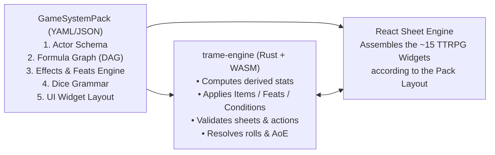

# TRAME — Phase 2: Generic Game System Engine & Built-in D&D 5e Pack

This document specifies the architecture of the generic game system engine in **TRAME** (`trame-engine`, compiled to native Rust on the server and WebAssembly in the browser) alongside its reference implementation: **D&D 5e (`dnd5e`)**.

---

## 1. Core Principle: "Data-Driven Rules, Widget-Driven Sheets"

In TRAME, the application source code contains no hardcoded rules for any specific tabletop RPG. Everything is driven by a **Game System Pack** (declarative YAML/JSON manifest + entity compendium) bound to each campaign.



---

## 2. Anatomy of a Generic `GameSystemPack`

### 2.1 Actor Data Schema (`actorSchema`) & Companions / Summons (Q16, Q23)

Defines the data structure stored in `actor.sheet_data` for each entity type in the game:
* **`character` (Player Character)**: Full attributes, multiclass progression, inventory, spellbook, feats, and background.
* **`npc` / `monster` (NPCs & Creatures)**: Compact stat block (CR, actions, reactions, legendary actions, and *Lair Actions*).
* **`summon` / `companion` (Familiars, Mounts, Summons, Wild Shape)**:
  * A player can be granted direct control by the DM (or via a spell like *Find Familiar* or a class feature like *Wild Shape*) over secondary actors linked to their main character (`parent_actor_id`).
  * **Handling *Wild Shape* / *Polymorph***: Applies a **Temporary Transformation Overlay (`Shapechange Overlay`)** onto the actor: temporarily replaces physical statistics (`STR`, `DEX`, `CON`, `AC`, `HP`, speed, senses, attacks) with those of the beast chosen from the bestiary while retaining the Druid's mental statistics (`INT`, `WIS`, `CHA`), skill proficiencies, and personality. When the form's HP drops to 0 (or the player reverts the transformation), the sheet and token automatically revert to their normal state with excess damage carried over.
* **`container` / `group_stash` (Party Chest, Room Loot, Lootable Corpse, Shop)**:
  * Shareable inventory actor on the map: the DM can place a *Chest* on the Table; once unlocked, nearby players can drag and drop items and gold coins directly into their own inventory (with automatic chat logging).

### 2.2 Derived Calculation Graph (`derivedDAG`)

A directed acyclic graph (DAG) of formulas evaluated in under $0.1\text{ ms}$ by `trame-engine` (Rust/WASM) in strict topological order:

```yaml
derived:
  abilities.*.mod: "floor((abilities.*.score + abilities.*.bonus - 10) / 2)"
  proficiencyBonus: "ceil(progression.totalLevel / 4) + 1"
  skills.*.total: "abilities[skills.*.ability].mod + (proficiencyBonus * skills.*.profMultiplier) + skills.*.effectBonus + skills.*.manualBonus"
  passivePerception: "10 + skills.perception.total + attributes.passivePerceptionBonus"
  spellcasting.saveDC: "8 + proficiencyBonus + abilities[spellcasting.ability].mod + spellcasting.dcBonus"
  spellcasting.attackBonus: "proficiencyBonus + abilities[spellcasting.ability].mod + spellcasting.attackBonus"
```

> **Escape Hatch**: Every computed value always includes a `manualBonus` field and an optional `overrideValue` field to support house rules without friction.

---

## 3. Unified Modifier Engine: Inventory, Equipment, Feats, Features & Conditions

### 3.1 The 4 Element Capabilities (`PassiveModifier`, `ToggleModifier`, `Grant`, `RollHook`)

| Effect Type | Behavior in `trame-engine` | Concrete Examples (D&D 5e) |
| :--- | :--- | :--- |
| **1. Passive Modifier (`PassiveModifier`)** | Automatically modifies a statistic, speed, or vision sensor whenever its activation condition holds (`when: "equipped && attuned"`). | • ***Alert* Feat**: `ADD +5` to `initiative.bonus`.<br>• **Plate Armor**: `SET_BASE 18` on `ac.value`.<br>• ***Goggles of Night* Item**: `ADD 60` to `senses.darkvision` (immediately updates the token's vision on the Table). |
| **2. Action Option / Toggle (`ToggleModifier`)** | Adds an on-the-fly toggleable checkbox in the attack panel or on the token HUD. | • ***Sharpshooter* / *Great Weapon Master* Feat**: Checkbox `[-5 Attack / +10 Damage]`.<br>• ***Rage* Feature**: Toggle `+2 melee STR damage` and `Resistance to bludgeoning/piercing/slashing damage`. |
| **3. Resource or Action Grant (`Grant`)** | Adds a rechargeable resource pool, innate spell, or combat-usable action. | • ***Second Wind* Feature**: Grants 1 resource `1/Short Rest` + 1 Bonus Action (`1d10 + @level`).<br>• ***Magic Initiate* Feat**: Grants 2 cantrips and 1 1st-level spell (`1/Long Rest`). |
| **4. Dynamic Roll Hook (`RollHook`)** | Modifies the dice formula or advantage mode at the moment a roll is resolved. | • ***Poisoned* Condition**: Forces `DISADVANTAGE` on attack rolls and ability checks.<br>• ***Bless* Spell**: Appends `+ 1d4` to attack rolls and saving throws. |

### 3.2 Deterministic Effect Stacking Pipeline & Stacking Rules (Q5, Q12)

To prevent conflicts when multiple items, feats, and spells modify the same statistic (e.g., *Mage Armor* vs. Monk *Unarmored Defense* vs. *Barkskin* vs. *+2 Shield*), `trame-engine` executes a strict pipeline in **5 priority-ordered phases**:

1. **`BASE_FORMULA` (Exclusive — Highest Wins)**:
   * Evaluates all candidate base formulas (e.g., `10 + DEX` default, `13 + DEX` for *Mage Armor*, `10 + DEX + WIS` for *Monk*, `14 + min(DEX, 2)` for *Chain Shirt*) and **retains only the highest value** (two base armor calculations never stack).
2. **`ADD` (Cumulative — Same-Named Spells Do Not Stack)**:
   * Sums flat bonuses (`+2` from an equipped Shield, `+1` from a *Ring of Protection*, `+2` from *Shield of Faith*).
   * **Named Source Uniqueness Rule (`stacking_group`)**: Two active effects sharing the same `source_spell_id` (e.g., two clerics casting *Bless* on the same fighter) do not stack; only the one with the strongest bonus or longest remaining duration applies.
3. **`MULTIPLY` (Factors)**:
   * Applies multipliers (e.g., `speed * 2` for *Haste / Dash*, `speed * 0.5` for *Slow*, `0` for *Grappled*).
4. **`MIN_FLOOR` / `MAX_CEILING` (Bounds)**:
   * Applies floors (e.g., *Barkskin*: `AC >= 16`, or Rogue *Reliable Talent*: `d20 >= 10`) and ceilings (e.g., ability score cap `20`).
5. **`OVERRIDE` (Manual DM / Player Override)**:
   * If the user has set an explicit forced value, it overwrites the final result.

### 3.3 Temporary Effect Durations, Turn Expiration & Automatic Concentration (Q12)

* Every active effect or condition applied to a token can have a duration expressed in **Combat Rounds / Turns**:
  * `until_start_of_source_next_turn` (e.g., *Shield* spell, *Stunning Strike*),
  * `until_end_of_target_next_turn`,
  * `rounds_remaining: N` (e.g., 10 rounds = 1 minute).
* When `combat.next_turn` advances initiative, `trame-engine` automatically decrements counters and removes expired conditions (with a notification in chat).
* **Concentration Automation (D&D 5e)**:
  1. **Exclusivity**: If a character already concentrating on *Bless* casts *Haste*, the engine automatically removes *Bless* (along with its ally bonuses or persistent AoE template on the map) before activating *Haste*.
  2. **Concentration Check on Damage**: Whenever a token carrying the `Concentrating` state takes damage $\Delta HP > 0$, `trame-engine` computes $\text{DC} = \max(10, \lfloor \Delta HP / 2 \rfloor)$ and immediately displays an interactive card in the chat / HUD: **"CON Saving Throw (DC X) to maintain concentration on [Spell]"**. On a failure, the spell and its AoE on the Table automatically end.

---

## 4. Damage Pipeline, Resistances & Combat Transparency Modes (Q6)

### 4.1 Damage Types, Resistances, Immunities & Temporary HP (D&D 5e)

Every damage roll is structured by type (`slashing`, `piercing`, `bludgeoning`, `fire`, `cold`, `lightning`, `poison`, `acid`, `necrotic`, `radiant`, `force`, `psychic`, `thunder` + tags `magical` / `silvered` / `adamantine`):
1. For each damage component, `trame-engine` checks the target's profile:
   * **Immunity** $\rightarrow 0$ damage.
   * **Resistance** $\rightarrow \lfloor \text{damage} / 2 \rfloor$ (non-stacking).
   * **Vulnerability** $\rightarrow \text{damage} \times 2$.
2. Applying damage to Hit Points first absorbs **Temporary HP (`hp.temp`)**, then reduces `hp.current` (and triggers *Instant Death by Massive Damage* or *Death Saving Throws* if `hp.current` drops to $0$).

### 4.2 Campaign Setting: Attack Transparency & Automation (Q6)

Because every DM has their own style of running the table, each campaign offers a 3-tier setting (changeable at any time):

| Campaign Setting | What the Player Sees | How Damage Is Applied |
| :--- | :--- | :--- |
| **1. `ASSISTED_DM_CONFIRM` (Default)** | The player sees their attack roll (`18 to hit`), but **does not see the monster's exact AC or secret resistances**. The server informs the DM whether it hits and the exact amount after resistances. | The DM clicks **`[Apply 14 damage (7 after fire resistance)]`** (or adjusts the value on the fly). |
| **2. `FULL_AUTOMATION` (Fast Play)** | Chat directly displays `Hit!` or `Miss!`. | HP and resistances are applied automatically as soon as damage is rolled (with an immediate **`[Undo]`** button for the DM). |
| **3. `MANUAL_CLASSIC` (Pure Tabletop)** | Displays only dice roll results in chat. | The DM or player manually clicks the target's `- HP` button. |

---

## 5. Compendium Editing, Homebrew & System Overrides (Q13)

* The built-in `dnd5e` pack (SRD 5.1 CC-BY-4.0) is provided as a **read-only base (`immutable base layer`)**, while each Instance and each Campaign has a **Homebrew Compendium Layer (`Custom Overlay`)**:
  * **1-Click Clone & Edit**: The DM can duplicate any SRD monster, spell, feat, or magic item to create a house variant, or create entries from scratch (in the UI or via the `compendium.upsert_entry` MCP tool).
  * **Cross-Campaign Sharing**: A DM can save Homebrew creations to their dedicated instance's global library for reuse across all their campaigns, or export them as a `.trame-pack.json` file.

---

## 6. Character Sheet Architecture & Character Builder / Level-Up Wizard

* **Catalog of ~15 Declarative TTRPG Widgets** assembled by the system's `sheetLayout` file (`HeroBannerWidget`, `AbilityScoreGridWidget`, `SavingThrowsWidget`, `SkillListWidget`, `HealthAndHitDiceWidget`, `DeathSavesWidget`, `ActionListWidget`, `SpellbookWidget`, `FeatAndFeatureTreeWidget`, `InventoryManagerWidget`, `DmSecretNotesWidget`).
* **Dual Editing Mode**:
  1. **Direct Editing ("Freeform")** + Drag-and-Drop from the Compendium.
  2. **Guided Wizard ("Character Builder & Level-Up Wizard")**: Species selection, Class/Subclass (multiclassing supported), ability score method (*Standard Array*, *27-Point Buy*, *4d6kh3 Roll*), starting equipment, and upon leveling up: HP gain calculation, new spells, and **ASI (+2 / +1/+1) or Feat** selection.
