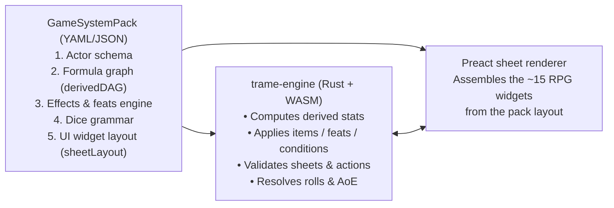

# TRAME — Phase 2: Generic Game System Engine & Built-in D&D 5e Pack

This document specifies the architecture of the **TRAME** generic game system engine (`trame-engine`, compiled natively in Rust on the server and to WebAssembly in the browser) and its reference implementation: **D&D 5e (`dnd5e`)**.

---

## 1. Core Principle: "Data-Driven Rules, Widget-Driven Sheets"

In TRAME, the application source code knows no rule specific to any roleplaying game. Everything relies on a **`GameSystemPack`** (a declarative YAML/JSON manifest + an entity compendium) attached to each campaign.



---

## 2. Anatomy of a Generic `GameSystemPack`

### 2.1 Actor Data Schema (`actorSchema`) & Companions / Summons (Q16, Q23)

Defines the structure of the data stored in `actor.sheet_data` for each entity type of the game:
* **`character` (player character)**: full abilities, multiclass progression, inventory, spellbook, feats and history.
* **`npc` / `monster` (NPCs & creatures)**: compact stat block (CR, actions, reactions, legendary actions, *Lair Actions*).
* **`summon` / `companion` (familiars, mounts, summons, beast form)**:
  * The GM (or a spell such as *Find Familiar*, or the *Wild Shape* feature) can give a player direct control of secondary actors linked to their main character (`parent_actor_id`).
  * **Handling *Wild Shape* / *Polymorph***: applies a **temporary transformation overlay (`Shapechange Overlay`)** to the actor. It temporarily replaces the physical statistics (`STR`, `DEX`, `CON`, AC, HP, speed, senses, attacks) with those of the beast chosen from the bestiary while keeping the Druid's mental statistics (`INT`, `WIS`, `CHA`), skills and personality. When the form's HP drops to 0 (or the player ends the transformation), the sheet and the token automatically return to their normal state and the excess damage carries over.
* **`container` / `group_stash` (party chest, room loot, searchable corpse, shop)**:
  * A shareable inventory actor on the map: the GM can drop a *Chest* on the table; once it is unlocked, nearby players can drag and drop items and gold directly into their own inventory (with an automatic log entry in the chat).

### 2.2 Derived Computation Graph (`derivedDAG`)

A directed acyclic graph (DAG) of formulas evaluated in less than $0.1\text{ ms}$ by `trame-engine` (Rust/WASM) in strict topological order. Per the ADR-0001 amendment, the WASM build of `evaluate_derived_dag` is the only evaluator of these formulas, in the browser and on the server. An unknown formula variable is an error, never a silent `0`.

```yaml
derived:
  abilities.*.mod: "floor((abilities.*.score + abilities.*.bonus - 10) / 2)"
  proficiencyBonus: "ceil(progression.totalLevel / 4) + 1"
  skills.*.total: "abilities[skills.*.ability].mod + (proficiencyBonus * skills.*.profMultiplier) + skills.*.effectBonus + skills.*.manualBonus"
  passivePerception: "10 + skills.perception.total + attributes.passivePerceptionBonus"
  spellcasting.saveDC: "8 + proficiencyBonus + abilities[spellcasting.ability].mod + spellcasting.dcBonus"
  spellcasting.attackBonus: "proficiencyBonus + abilities[spellcasting.ability].mod + spellcasting.attackBonus"
```

> **Escape hatch**: every computed value always has a `manualBonus` field and an optional `overrideValue` field so house rules need no workaround.

---

## 3. The Unified Engine: Inventory, Equipment, Feats, Features & Conditions

### 3.1 The 4 Capabilities of an Element (`PassiveModifier`, `ToggleModifier`, `Grant`, `RollHook`)

| Effect type | Behavior in `trame-engine` | Concrete examples (D&D 5e) |
| :--- | :--- | :--- |
| **1. Passive modifier (`PassiveModifier`)** | Automatically changes a statistic, a speed or a vision sense while its activation condition is true (`when: "equipped && attuned"`). | • **Feat *Alert***: `ADD +5` to `initiative.bonus`.<br>• **Plate armor**: base formula `18` on `ac.value`.<br>• **Item *Goggles of Night***: `ADD 60` to `senses.darkvision` (immediately updates the token's vision on the table). |
| **2. Action option / toggle (`ToggleModifier`)** | Adds a checkbox that can be toggled on the fly in the attack panel or on the token HUD. | • **Spell *Bless***: checkbox `[+1d4 attack rolls and saving throws]`.<br>• **Feature *Rage***: toggles `+2 STR melee damage` and resistance to bludgeoning/piercing/slashing damage. |
| **3. Resource or action grant (`Grant`)** | Adds a rechargeable `ResourcePool`, an innate spell or an action usable in combat. | • **Feature *Second Wind***: grants 1 resource `1/short rest` + 1 Bonus Action (`1d10 + @level`).<br>• **Feat *Magic Initiate***: grants 2 cantrips and 1 level-1 spell (`1/long rest`). |
| **4. Dynamic roll modifier (`RollHook`)** | Changes the dice formula or the advantage mode when a roll is resolved. | • **Condition *Poisoned***: forces `DISADVANTAGE` on attack rolls and ability checks.<br>• **Spell *Bless***: adds `+ 1d4` to attack rolls and saving throws. |

### 3.2 Deterministic `ActiveEffect` Pipeline & Stacking Rules (Q5, Q12)

To avoid conflicts when several items, feats and spells change the same statistic (for example *Mage Armor* vs Monk *Unarmored Defense* vs *Barkskin* vs a *+2 Shield*), `trame-engine` evaluates every `ActiveEffect` through a strict pipeline of ordered phases (`ModifierPhase`): **`Base` -> `Add` -> `Multiply` -> `Override` -> `ClampMin` / `ClampMax`**.

1. **`Base` (exclusive — best wins)**:
   * Evaluates every candidate base formula (for example `10 + DEX` by default, `13 + DEX` for *Mage Armor*, `10 + DEX + WIS` for a Monk, `14 + min(DEX, 2)` for a *Chain Shirt*) and **keeps only the highest result** (two base armor computations never add up).
2. **`Add` (cumulative — same-named effects do not stack)**:
   * Adds flat bonuses (`+2` from an equipped shield, `+1` from a *Ring of Protection*, `+2` from *Shield of Faith*).
   * **Named-source uniqueness rule (`source_name`)**: two active effects with the same `source_name` (for example two clerics casting *Bless* on the same fighter) do not stack; only the one with the largest magnitude applies.
3. **`Multiply` (factors)**:
   * Applies multipliers (for example `speed * 2` for *Haste* / *Dash*, `speed * 0.5` for *Slow*, `0` for *Grappled*).
4. **`Override` (forced value)**:
   * Replaces the computed value outright (for example *Gauntlets of Ogre Power* `STR = 19`, or an explicit GM/player forced value). When several overrides collide, the highest one is kept.
5. **`ClampMin` then `ClampMax` (bounds)**:
   * Applies floors first (for example *Barkskin*: `AC >= 16`, or the Rogue's *Reliable Talent*: `d20 >= 10`), then ceilings (for example ability score maximum `20`).

### 3.3 Temporary Effect Duration, Per-Turn Expiry & Automatic Concentration (Q12)

* Every active effect or `Condition` applied to a token can have a duration expressed in **combat rounds / turns** (`TurnTrigger`):
  * `until_start_of_source_next_turn` (for example the *Shield* spell, *Stunning Strike*),
  * `until_end_of_target_next_turn`,
  * `rounds_remaining: N` (for example 10 rounds = 1 minute).
* When `AdvanceTurn` moves the initiative forward, `trame-engine` automatically decrements the counters and removes expired conditions (with a notification in the chat).
* **Concentration automation (D&D 5e)**:
  1. **Exclusivity**: if a character already concentrating on *Bless* casts *Haste*, the engine automatically removes *Bless* (and its bonuses on allies, or its persistent AoE template on the map) before activating *Haste*.
  2. **Concentration check on damage (`ConcentrationCheckPrompt`)**: as soon as a token with the `Concentrating` state takes damage $\Delta HP > 0$, `trame-engine` computes $\text{DC} = \max(10, \lfloor \Delta HP / 2 \rfloor)$ and immediately shows an interactive card in the chat / HUD: **"CON saving throw (DC X) to maintain concentration on [Spell]"**. On a failure, the spell and its AoE on the table end automatically (`BreakConcentration`).

---

## 4. Damage Pipeline, Resistances & Combat Transparency Modes (Q6)

### 4.1 Damage Types, Resistances, Immunities & Temporary HP (D&D 5e)

Every damage roll is structured by `DamageType` (`slashing`, `piercing`, `bludgeoning`, `fire`, `cold`, `lightning`, `poison`, `acid`, `necrotic`, `radiant`, `force`, `psychic`, `thunder` + a `magical` / `silvered` / `adamantine` tag):
1. For each damage component, `trame-engine` checks the target's profile (`DamageMitigation`, from the target's server-side data, never from the client):
   * **Immune** → 0 damage.
   * **Resistant** → $\lfloor \text{damage} / 2 \rfloor$ (does not stack).
   * **Vulnerable** → $\text{damage} \times 2$ (saturating arithmetic).
2. Applying damage to hit points first absorbs **temporary HP (`TempHP`, `hp.temp`)**, then reduces `hp.current`. At 0 HP this triggers `InstantDeath` (massive damage) or `DeathSavingThrow` failures (damage at 0 HP adds one failure, two on a critical hit).

### 4.2 Campaign Setting: Attack Transparency & Automation (Q6)

Every GM has their own style, so the campaign offers a 3-level setting (changeable at any time):

| Campaign setting | What the player sees | How damage is applied |
| :--- | :--- | :--- |
| **1. `ASSISTED_DM_CONFIRM` (default)** | The player sees their attack roll (`18 to hit`) but **not the monster's exact AC or secret resistances**. The server tells the GM whether it hits and the exact amount after resistances. | The GM clicks **`[Apply 14 damage (7 after fire resistance)]`** (or edits the value on the fly). |
| **2. `FULL_AUTOMATION` (fast play)** | The chat shows `Hit!` or `Miss!` directly. | HP and resistances are applied automatically as soon as damage is rolled (with an immediate **`[Undo]`** button for the GM). |
| **3. `MANUAL_CLASSIC` (pure paper table)** | Only the dice results are shown in the chat. | The GM or the player clicks the target's `- HP` button. |

---

## 5. Compendium Editing, Homebrew & System Overrides (Q13)

* The built-in `dnd5e` pack (`SystemSRD`, SRD 5.2.1 CC-BY-4.0, ADR-0038) is provided as a **read-only base layer**, but each instance and each campaign has a **homebrew compendium layer** (`InstanceLibrary`, `CampaignHomebrew`), resolved by the `CompendiumResolver` in the order `CAMPAIGN_HOMEBREW` > `INSTANCE_LIBRARY` > `SYSTEM_SRD`:
  * **Clone & edit in 1 click**: the GM can duplicate any SRD monster, spell, feat or magic item to create a house variant, or create one from scratch (in the UI or via the MCP tool `compendium.upsert_entry`).
  * **Cross-campaign sharing**: a GM can save their homebrew creations in their dedicated instance's library to reuse them in all their campaigns, or export them as a `.trame-pack.json` file.

---

## 6. Character Sheet Architecture & Creation / Level-Up Wizard

* **Catalog of ~15 declarative RPG widgets** assembled by the system's `sheetLayout` file (`HeroBannerWidget`, `AbilityScoreGridWidget`, `SavingThrowsWidget`, `SkillListWidget`, `HealthAndHitDiceWidget`, `DeathSavesWidget`, `ActionListWidget`, `SpellbookWidget`, `FeatAndFeatureTreeWidget`, `InventoryManagerWidget`, `DmSecretNotesWidget`).
* **Two editing modes**:
  1. **Direct editing ("Freeform")** + drag and drop from the compendium.
  2. **Guided wizard ("Character Builder & Level-Up Wizard")**: species, class/subclass (multiclassing supported), ability score method (*Standard Array*, *Point Buy 27*, *Roll 4d6kh3*), starting equipment, and on level-up: HP computation, new spells and an **ASI (+2 / +1+1) or Feat** choice.
* Sheet changes are persisted through REST `PUT /api/v1/campaigns/{id}/actors/{actor_id}` with `expected_version` (ADR-0037), never through a tactical `TrameCommand`.
