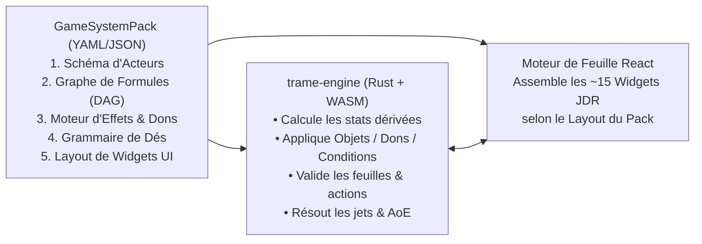

# TRAME — Phase 2 : Moteur de Système de Jeu Générique & Pack Built-in D&D 5e

Ce document spécifie l'architecture du moteur générique de systèmes de jeu de **TRAME** (`trame-engine`, compilé en Rust côté serveur et en WebAssembly côté navigateur) ainsi que son implémentation de référence : **D&D 5e (`dnd5e`)**.

---

## 1. Principe Fondamental : "Data-Driven Rules, Widget-Driven Sheets"

Dans TRAME, le code source de l'application ne connaît aucune règle spécifique à un jeu de rôle. Tout repose sur un **Game System Pack** (manifeste déclaratif YAML/JSON + compendium d'entités) associé à chaque campagne.



---

## 2. Anatomie d'un `GameSystemPack` Générique

### 2.1 Schéma de Données des Acteurs (`actorSchema`) & Compagnons / Invocations (Q16, Q23)

Définit la structure des données stockées dans `actor.sheet_data` pour chaque type d'entité du jeu :
* **`character` (Personnage Joueur)** : Attributs complets, progression multi-classes, inventaire, grimoire, dons et historique.
* **`npc` / `monster` (PNJ & Créatures)** : Stat-block compact (FP/CR, actions, réactions, actions légendaires, actions de repaire / *Lair Actions*).
* **`summon` / `companion` (Familiers, Montures, Invocations, Forme Animale)** :
  * Un joueur peut se voir accorder par le MJ (ou par un sort comme *Appel de familier* ou la capacité *Forme Sauvage / Wild Shape*) le contrôle direct d'acteurs secondaires liés à son personnage principal (`parent_actor_id`).
  * **Gestion de la *Forme Sauvage (Wild Shape)* / *Polymorphie*** : Applique une **Enveloppe de Transformation Temporaire (`Shapechange Overlay`)** sur l'acteur : remplace temporairement les statistiques physiques (`STR`, `DEX`, `CON`, `CA`, `PV`, vitesse, sens, attaques) par celles de la bête choisie dans le bestiaire tout en conservant les statistiques mentales (`INT`, `WIS`, `CHA`), les compétences et la personnalité du Druide. Lorsque les PV de la forme tombent à 0 (ou que le joueur annule la transformation), la fiche et le token reviennent automatiquement à leur état normal avec report des dégâts excédentaires !
* **`container` / `group_stash` (Coffre de Groupe, Butin de Salle, Cadavre Fouillable, Boutique)** :
  * Acteur d'inventaire partageable sur la carte : le MJ peut déposer un *Coffre* sur la Table ; lorsqu'il le déverrouille, les joueurs à proximité peuvent glisser-déposer directement les objets et pièces d'or vers leur propre inventaire (avec journalisation automatique dans le chat).

### 2.2 Graphe de Calculs Dérivés (`derivedDAG`)

Un graphe acyclique orienté (DAG) de formules évaluées en moins de $0.1\text{ ms}$ par `trame-engine` (Rust/WASM) dans un ordre topologique strict :

```yaml
derived:
  abilities.*.mod: "floor((abilities.*.score + abilities.*.bonus - 10) / 2)"
  proficiencyBonus: "ceil(progression.totalLevel / 4) + 1"
  skills.*.total: "abilities[skills.*.ability].mod + (proficiencyBonus * skills.*.profMultiplier) + skills.*.effectBonus + skills.*.manualBonus"
  passivePerception: "10 + skills.perception.total + attributes.passivePerceptionBonus"
  spellcasting.saveDC: "8 + proficiencyBonus + abilities[spellcasting.ability].mod + spellcasting.dcBonus"
  spellcasting.attackBonus: "proficiencyBonus + abilities[spellcasting.ability].mod + spellcasting.attackBonus"
```

> **Escape Hatch** : Chaque valeur calculée possède toujours un champ `manualBonus` et un champ optionnel `overrideValue` pour permettre les règles maison sans friction.

---

## 3. Le Moteur Unifié : Inventaire, Équipement, Dons (*Feats*), Capacités & États

### 3.1 Les 4 Capacités d'un Élément (`PassiveModifier`, `ToggleModifier`, `Grant`, `RollHook`)

| Type d'Effet | Fonctionnement dans `trame-engine` | Exemples Concrets (D&D 5e) |
| :--- | :--- | :--- |
| **1. Modificateur Passif (`PassiveModifier`)** | Modifie automatiquement une statistique, une vitesse ou un capteur de vision tant que sa condition d'activation est vraie (`when: "equipped && attuned"`). | • **Don *Vigilant (Alert)*** : `ADD +5` à `initiative.bonus`.<br>• **Armure de plates** : `SET_BASE 18` sur `ac.value`.<br>• **Objet *Lunettes de la nuit*** : `ADD 60` à `senses.darkvision` (met immédiatement à jour la vision du token sur la Table). |
| **2. Option d'Action / Bascule (`ToggleModifier`)** | Ajoute une case à cocher activable à la volée dans le panneau d'attaque ou sur le HUD du token. | • **Don *Tireur d'élite (Sharpshooter)* / *GWM*** : Case à cocher `[-5 Attaque / +10 Dégâts]`.<br>• **Capacité *Rage*** : Bascule `+2 dégâts de mêlée STR` et `Résistance aux dégâts contondants/perforants/tranchants`. |
| **3. Octroi de Ressource ou d'Action (`Grant`)** | Ajoute une jauge de ressource rechargeable, un sort inné ou une action utilisable en combat. | • **Capacité *Second Souffle*** : Octroie 1 ressource `1/Repos Court` + 1 Action Bonus (`1d10 + @level`).<br>• **Don *Initié à la magie*** : Octroie 2 sorts mineurs et 1 sort de niveau 1 (`1/Repos Long`). |
| **4. Modificateur de Jet Dynamique (`RollHook`)** | Modifie la formule de dé ou le mode d'avantage au moment où un jet est résolu. | • **État *Empoisonné*** : Force `DISADVANTAGE` sur les jets d'attaque et tests de caractéristique.<br>• **Sort *Bénédiction (Bless)*** : Ajoute `+ 1d4` aux jets d'attaque et de sauvegarde. |

### 3.2 Pipeline Déterministe d'Empilement des Effets & Règles d'Empilement (Q5, Q12)

Pour éviter tout conflit lorsque plusieurs objets, dons et sorts modifient la même statistique (ex: *Armure de Mage* vs *Défense sans armure de Moine* vs *Écorce / Barkskin* vs *Bouclier +2*), `trame-engine` exécute un pipeline strict en **5 phases ordonnées par priorité** :

1. **`BASE_FORMULA` (Exclusif — Le meilleur gagne)** :
   * Calcule toutes les formules de base candidates (ex: `10 + DEX` par défaut, `13 + DEX` pour *Armure de Mage*, `10 + DEX + WIS` pour *Moine*, `14 + min(DEX, 2)` pour *Chemise de mailles*) et **retient uniquement la plus élevée** (deux calculs d'armure de base ne s'additionnent jamais).
2. **`ADD` (Cumulatif — Non-cumul des sorts de même nom)** :
   * Additionne les bonus plats (`+2` d'un Bouclier équipé, `+1` d'un *Anneau de protection*, `+2` de *Bouclier de la foi*).
   * **Règle d'unicité de source nommée (`stacking_group`)** : Deux effets actifs portant le même `source_spell_id` (ex: deux clercs lançant *Bénédiction* sur le même guerrier) ne se cumulent pas ; seul celui ayant la durée ou le bonus le plus fort s'applique.
3. **`MULTIPLY` (Facteurs)** :
   * Applique les multiplicateurs (ex: `vitesse * 2` pour *Hâte / Dash*, `vitesse * 0.5` pour *Ralentissement*, `0` pour *Agrippé / Grappled*).
4. **`MIN_FLOOR` / `MAX_CEILING` (Bornes)** :
   * Applique les planchers (ex: *Écorce / Barkskin* : `CA >= 16`, ou *Talent fiable / Reliable Talent* du Roublard : `d20 >= 10`) et les plafonds (ex: caractéristique max `20`).
5. **`OVERRIDE` (Forçage manuel MJ / Joueur)** :
   * Si l'utilisateur a défini une valeur forcée explicite, elle écrase le résultat final.

### 3.3 Durée des Effets Temporaires, Expiration par Tour & Concentration Automatique (Q12)

* Chaque effet actif ou condition appliqué à un token peut avoir une durée exprimée en **Rounds / Tours de combat** :
  * `until_start_of_source_next_turn` (ex: sort *Bouclier / Shield*, *Coup étourdissant*),
  * `until_end_of_target_next_turn`,
  * `rounds_remaining: N` (ex: 10 rounds = 1 minute).
* Lorsque `combat.next_turn` avance l'initiative, `trame-engine` décrémente automatiquement les compteurs et retire les conditions expirées (avec notification dans le chat).
* **Automatisation de la Concentration (D&D 5e)** :
  1. **Exclusivité** : Si un personnage déjà concentré sur *Bénédiction* lance *Hâte*, le moteur retire automatiquement *Bénédiction* (et ses bonus sur les alliés ou son gabarit AoE persistant sur la carte) avant d'activer *Hâte*.
  2. **Test de Concentration sur Dégâts** : Dès qu'un token portant l'état `Concentrating` subit des dégâts $\Delta PV > 0$, `trame-engine` calcule $\text{DD} = \max(10, \lfloor \Delta PV / 2 \rfloor)$ et affiche immédiatement une carte interactive dans le chat / HUD : **"Jet de Sauvegarde de CON (DD X) pour maintenir la concentration sur [Sort]"**. En cas d'échec, le sort et son AoE sur la Table s'éteignent automatiquement.

---

## 4. Pipeline de Dégâts, Résistances & Modes de Transparence de Combat (Q6)

### 4.1 Types de Dégâts, Résistances, Immunités & PV Temporaires (D&D 5e)

Chaque jet de dégâts est structuré par type (`slashing`, `piercing`, `bludgeoning`, `fire`, `cold`, `lightning`, `poison`, `acid`, `necrotic`, `radiant`, `force`, `psychic`, `thunder` + tag `magical` / `silvered` / `adamantine`) :
1. Pour chaque composant de dégâts, `trame-engine` vérifie le profil de la cible :
   * **Immunité** $\rightarrow 0$ dégât.
   * **Résistance** $\rightarrow \lfloor \text{dégâts} / 2 \rfloor$ (non cumulable).
   * **Vulnérabilité** $\rightarrow \text{dégâts} \times 2$.
2. L'application aux Points de Vie absorbe d'abord les **PV Temporaires (`hp.temp`)**, puis réduit `hp.current` (et déclenche la règle de *Mort instantanée par dégâts massifs* ou les *Jets contre la mort* si `hp.current` tombe à $0$).

### 4.2 Réglage de Campagne : Transparence & Automatisation des Attaques (Q6)

Chaque MJ ayant son propre style de maîtrise, la campagne propose un réglage à 3 niveaux (modifiable à tout moment) :

| Réglage de Campagne | Ce que voit le Joueur | Comment sont appliqués les Dégâts |
| :--- | :--- | :--- |
| **1. `ASSISTED_DM_CONFIRM` (Par défaut)** | Le joueur voit son jet d'attaque (`18 pour toucher`), mais **ne voit pas la CA exacte ni les résistances secrètes du monstre**. Le serveur indique au MJ si ça touche et le montant exact après résistances. | Le MJ clique sur **`[Appliquer 14 dégâts (7 après résistance feu)]`** (ou modifie la valeur à la volée). |
| **2. `FULL_AUTOMATION` (Jeu rapide)** | Le chat affiche directement `Touché !` ou `Manqué !`. | Les PV et résistances sont appliqués automatiquement dès que les dégâts sont roulés (avec bouton **`[Annuler / Undo]`** immédiat pour le MJ). |
| **3. `MANUAL_CLASSIC` (Table papier pure)** | Affiche uniquement les résultats des dés dans le chat. | Le MJ ou le joueur clique sur le bouton `- PV` de la cible. |

---

## 5. Édition du Compendium, Homebrew & Surcharge des Systèmes (Q13)

* Le pack built-in `dnd5e` (SRD 5.1 CC-BY-4.0) est fourni en **lecture seule de base (`immutable base layer`)**, mais chaque Instance et chaque Campagne possède une **Couche de Compendium Homebrew (`Custom Overlay`)** :
  * **Cloner & Modifier en 1 clic** : Le MJ peut dupliquer n'importe quel monstre, sort, don ou objet magique du SRD pour créer une variante maison, ou en créer de zéro (dans l'UI ou via l'outil MCP `compendium.upsert_entry`).
  * **Partage Inter-Campagnes** : Un MJ peut enregistrer ses créations Homebrew dans la bibliothèque globale de son instance dédiée pour les réutiliser dans toutes ses campagnes, ou les exporter en fichier `.trame-pack.json`.

---

## 6. Architecture de la Feuille de Personnage & Assistant de Création / Level-Up

* **Catalogue de ~15 Widgets JDR Déclaratifs** assemblés par le fichier `sheetLayout` du système (`HeroBannerWidget`, `AbilityScoreGridWidget`, `SavingThrowsWidget`, `SkillListWidget`, `HealthAndHitDiceWidget`, `DeathSavesWidget`, `ActionListWidget`, `SpellbookWidget`, `FeatAndFeatureTreeWidget`, `InventoryManagerWidget`, `DmSecretNotesWidget`).
* **Double Mode d'Édition** :
  1. **Édition Directe ("Freeform")** + Glisser-déposer depuis le Compendium.
  2. **Assistant Guidé ("Character Builder & Level-Up Wizard")** : Choix Espèce, Classe/Sous-classe (multiclassage supporté), méthode de caractéristiques (*Standard Array*, *Point Buy 27*, *Jet 4d6kh3*), équipement de départ, et lors de la montée de niveau : calcul des PV, nouveaux sorts et choix **ASI (+2 / +1+1) ou Don (*Feat*)**.
