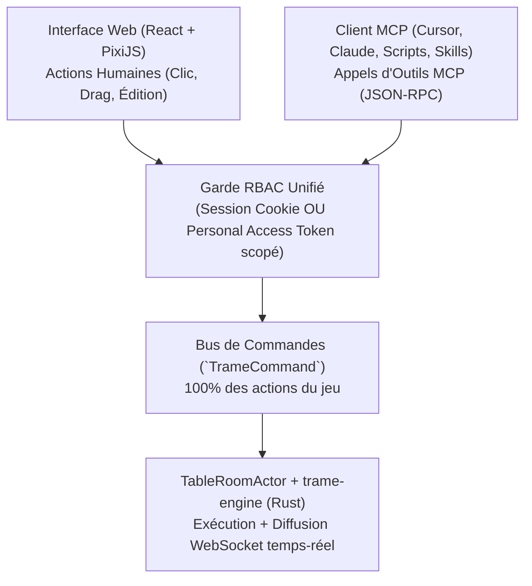

# TRAME — Phase 3 : Serveur MCP Natif, Système de Notes Wiki & Skills Externes

Ce document spécifie l'architecture du **Serveur MCP Natif** de **TRAME**, le **Système de Notes & Lore (style Wiki / Obsidian)**, la résolution de conflits d'édition temps-réel, et le principe de **Parité Totale UI $\leftrightarrow$ MCP**.

---

## 1. Principe Architectural : Parité 100% entre l'UI et le Serveur MCP

Dans TRAME, **toute action réalisable par un humain dans l'interface web (MJ ou Joueur) est réalisable par un agent via le serveur MCP**, avec exactement les mêmes règles de validation (`trame-engine`) et le même contrôle d'accès (RBAC).

L'interface Web et le serveur MCP émettent tous les deux les mêmes **Commandes de Domaine Typées (`TrameCommand`)** vers le serveur Rust.

---

## 2. Mode "Dry-Run / Staging Proposal" & Batching Atomique MCP (Q7)

Lorsqu'un agent IA exécute des opérations lourdes ou créatives via MCP (ex: *"Génère une embuscade avec 6 monstres et change les murs de la salle"* ou *"Réécris les notes de la session"*), le MJ peut choisir entre deux modes d'exécution :

1. **Exécution Directe (`commit: true` par défaut) + Undo 1-Clic** :
   * L'outil MCP `mcp.execute_batch` regroupe plusieurs commandes (`spawn_tokens`, `set_lights`, `set_walls`) en une **seule transaction d'historique (`BatchUndoEntry`)**.
   * Une bannière discrète apparaît chez le MJ : `🤖 Agent MCP : "Embuscade Gobeline créée (8 actions)" [Annuler le lot]`. Un seul clic sur *Annuler* défait l'intégralité du batch MCP !
2. **Mode Prévisualisation / Approbation (`dry_run: true` ou `mode: "propose"`)** :
   * L'agent envoie un lot de modifications en mode `propose`.
   * Sur la Table du MJ, les nouveaux tokens, murs ou lumières proposés par l'IA s'affichent en **surbrillance fantôme bleutée ( invisibles pour les joueurs)** avec un bouton **`[✓ Appliquer sur la Table]`** ou **`[✕ Rejeter]`**.

---

## 3. Système de Notes & Lore : Wiki Structuré, Liens Croisés & Handouts

### 3.1 Les 3 Espaces de Visibilité (`Visibility Scopes`)

1. **`PRIVATE` (Carnet Personnel)** : Strictement privé à son auteur.
2. **`PARTY` (Wiki & Journal de Groupe)** : Carnet collaboratif partagé par toute la table (*Journal des sessions*, *Quêtes actives*, *Indices découverts*, *PNJ connus*).
3. **`DM_ONLY` (Bible de Campagne & Secrets MJ)** :
   * Arborescence réservée au MJ, supportant dans n'importe quelle note `PARTY` des blocs secrets `:::dm` et des blocs révélables `:::handout[title="..." revealed=false]`.
   * **Filtrage Serveur Strict** : Tant que `revealed=false`, le serveur Rust purge du Markdown tous les blocs `:::dm` et `:::handout` avant de les transmettre aux joueurs.

### 3.2 Édition Collaborative Temps-Réel & Synchronisation Sans Conflit Obsidian / MCP (Q8)

Pour éviter qu'un joueur éditant le *Journal de Groupe* n'écrase les modifications d'un autre joueur, ou qu'une synchronisation MCP (Obsidian / Notion) n'écrase une note modifiée en séance :

1. **Édition Temps-Réel dans l'UI (CRDT Yjs / `yrs` en Rust)** :
   * Les notes ouvertes simultanément par plusieurs membres utilisent le crate Rust **`yrs` (port officiel de Yjs en Rust)** côté serveur et Yjs dans l'éditeur Markdown client : on voit les curseurs des autres joueurs en direct et aucune frappe n'est jamais perdue.
2. **Synchronisation Externe Optimiste (`ETag` + `3-Way Merge` Markdown)** :
   * Chaque note possède un numéro de révision monotone (`revision`) et un hash `content_sha256`.
   * Lorsqu'un outil MCP appelle `notes.sync_batch` avec `base_revision`, `trame-server` effectue :
     * Si la note n'a pas changé côté TRAME : mise à jour directe (*fast-forward*).
     * Si la note a été modifiée des deux côtés sur des paragraphes différents : **fusion automatique à 3 voies (`diffy::merge` en Rust)** en préservant les blocs `:::dm` !
     * Si le même paragraphe a été modifié des deux côtés : enregistre une version de conflit dans l'historique de la note sans perdre aucune donnée et alerte le MJ.

### 3.3 Journal Structuré d'Événements de Session (`Session Event Stream` — Q17)

En plus du chat textuel, chaque session active enregistre un **flux d'événements typés (`session_events`)** :
* Chaque événement horodaté contient : `event_type` (`combat_started`, `attack_rolled`, `creature_defeated`, `door_opened`, `handout_revealed`, `loot_acquired`, `chat_in_character`), les acteurs impliqués et le lieu/carte.
* **Ressource MCP dédiée (`campaign://{id}/sessions/{num}/timeline`)** : Permet à un skill IA (`/session-recap` ou `/obsidian-journal-sync`) de lire en une fraction de seconde toute la chronologie objective de la soirée pour rédiger automatiquement la chronique narrative de la session et mettre à jour l'état des PNJ dans le Wiki.

---

## 4. Catalogue Exhaustif des Capacités MCP (100% des Actions de TRAME)

### 4.1 Outils de Table, Mouvement, Combat & AoE (`table.*` & `combat.*`)

| Outil MCP (`Tool`) | Paramètres principaux | Rôle autorisé | Effet en direct sur la Table |
| :--- | :--- | :--- | :--- |
| `table.set_mode` | `mode: "exploration" \| "combat"`, `paused: bool` | MJ | Bascule entre le mode Exploration et le mode Tour-par-Tour, ou met la table en pause. |
| `table.set_lighting_preset` | `preset: "day" \| "dusk" \| "moonlight" \| "dark"` | MJ | Change instantanément le cycle Jour/Nuit et l'éclairage global de la carte. |
| `table.move_token` | `token_id`, `path: [{x, y, z?}]`, `ignore_walls?: bool` | MJ ou Propriétaire | Déplace le token le long du chemin (vérifie collisions, altitude, vitesse et met à jour la vision). |
| `table.undo_last_action` | `action_id?` | MJ | Annule le dernier mouvement/action (ou batch MCP), recrédite la vitesse et restaure le brouillard. |
| `table.interact_door` | `wall_id`, `state: "open" \| "closed" \| "locked" \| "secret"` | MJ / Joueur ($\le 1$ case) | Ouvre, ferme, verrouille ou cache une porte et recalcule les lignes de vue. |
| `table.place_aoe` | `shape`, `origin`, `dimensions`, `discretization_rule?`, `persistent: bool`, `effects` | MJ ou Joueur | Pose un gabarit de sort (découpé par les murs), retourne les cibles touchées et applique le terrain/lumière si persistant. |
| `table.resolve_aoe_save` | `aoe_id`, `ability: "DEX"`, `dc: 15`, `damage_formula: "8d6"`, `damage_type: "fire"` | MJ ou Lanceur | Lance les jets de sauvegarde des cibles et applique les dégâts (avec calcul des résistances/immunités). |
| `combat.start_or_end` | `active: bool`, `participants?: [token_id]` | MJ | Lance ou termine le suivi d'initiative. |
| `combat.roll_initiative` | `token_ids: [...]` | MJ ou Joueur | Calcule et lance l'initiative selon la règle du système. |
| `combat.update_turn_economy` | `token_id`, `movement_left?`, `action?`, `bonus_action?`, `reaction?` | MJ ou Joueur actif | Consomme ou redonne une Action, Action Bonus, Réaction ou du mouvement. |
| `combat.next_turn` | — | MJ ou Joueur actif | Passe au combattant suivant, décrémente la durée des effets/conditions et réinitialise le budget du tour. |

### 4.2 Outils d'Architecture de Carte, Murs, Lumières, Audio & Brouillard (`maps.*`)

| Outil MCP (`Tool`) | Description | Rôle |
| :--- | :--- | :--- |
| `maps.create` / `maps.configure_grid` | Crée une carte, règle la grille (carrée/hex, taille px, échelle `5 ft`), et l'active à la table. | MJ |
| `maps.import_uvtt` / `maps.export_uvtt` | Importe ou exporte un fichier standard `.uvtt` / `.dd2vtt` avec son image, ses murs, ses portes et ses sources lumineuses. | MJ |
| `maps.set_walls` | Ajoute, modifie ou supprime par lot des segments (`solid`, `window`, `terrain`, `door`, `curtain`), leur hauteur `top_z`, des polygones `indoor`, des toits (`overhead`) et des téléporteurs/escaliers (`teleporters`). | MJ |
| `maps.set_lights` / `maps.set_audio_sources` | Place et configure les sources de lumière dynamique et les sources audio spatialisées sur la carte. | MJ |
| `maps.edit_fog` | Révèle ou masque des zones du brouillard manuel, ou réinitialise la mémoire d'exploration. | MJ |
| `maps.spawn_tokens` | Place un ou plusieurs tokens sur la carte à partir d'un acteur ou du bestiaire SRD. | MJ |

### 4.3 Outils de Personnages, Compagnons, Conteneurs & Compendium (`actors.*` & `compendium.*`)

| Outil MCP (`Tool`) | Description | Rôle |
| :--- | :--- | :--- |
| `systems.list` / `systems.register_pack` | Liste les systèmes ou installe/met à jour un `GameSystemPack` déclaratif (YAML/JSON) à chaud. | Admin / MJ |
| `compendium.search` / `compendium.upsert_entry` | Recherche dans le SRD ou crée/modifie un monstre, sort, don ou objet Homebrew dans la campagne ou l'instance. | MJ / Joueur (lecture) |
| `actors.create` / `actors.update_sheet` | Crée ou met à jour un PJ, un PNJ, un Familier/Invocation (`companion`) ou un Coffre de butin (`container`). | MJ / Joueur (son PJ) |
| `actors.transform_shape` | Applique ou retire une transformation temporaire (*Forme Sauvage / Wild Shape*, *Polymorphie*) à partir d'une créature du bestiaire. | MJ / Joueur (son PJ) |
| `actors.manage_inventory` | Ajoute, équipe, harmonise (`attune`), identifie ou transfère un objet entre un personnage et un coffre de groupe. | MJ / Joueur (son PJ) |
| `actors.roll_action` | Exécute un jet de caractéristique, compétence, sauvegarde, attaque d'arme ou sort depuis la fiche. | MJ / Joueur (son PJ) |
