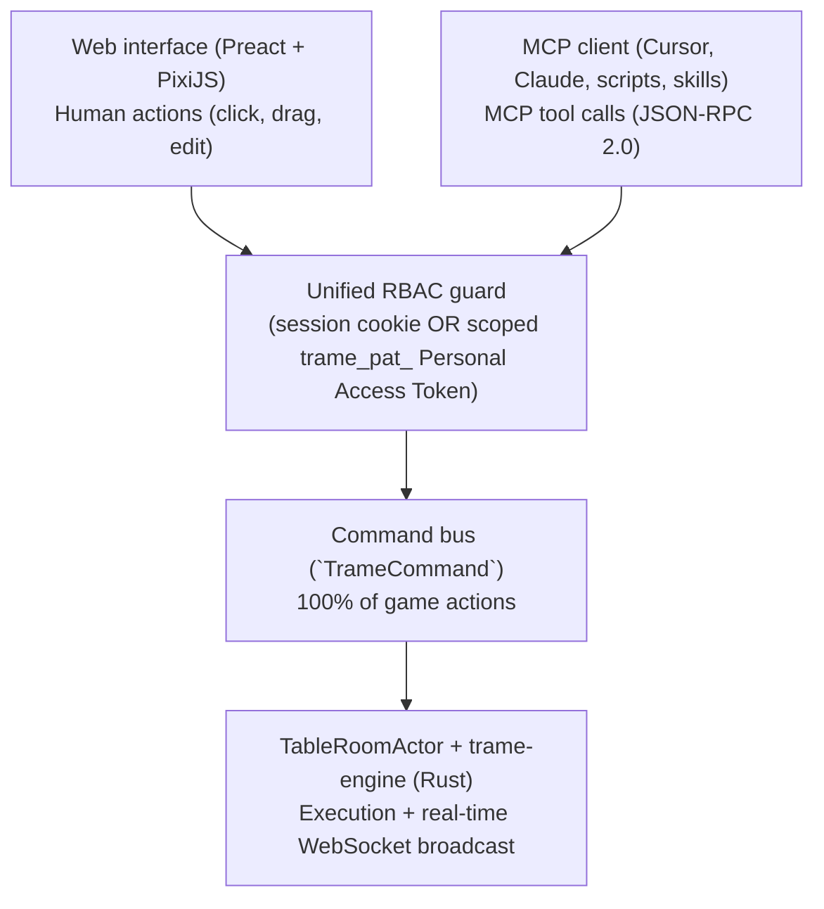

# TRAME — Phase 3: Native MCP Server, Wiki Notes System & External Skills

This document specifies the architecture of the **TRAME native MCP server**, the **notes & lore system (wiki / Obsidian style)**, real-time edit conflict resolution, and the principle of **full UI ↔ MCP parity**.

---

## 1. Architectural Principle: 100% Parity Between the UI and the MCP Server

In TRAME, **every action a human can perform in the web interface (GM or player) can be performed by an agent through the MCP server**, with exactly the same validation rules (`trame-engine`) and the same access control (RBAC).

The web interface and the MCP server both emit the same **typed domain commands (`TrameCommand`)** to the Rust server.

The MCP endpoint is JSON-RPC 2.0 at `POST /api/v1/mcp`, authenticated with a `trame_pat_` Personal Access Token. The `tools/list` input schemas are generated from the `TrameCommand` enum, so the tools and the command bus cannot drift.

---

## 2. Staging Mode & Atomic MCP Batches (Q7)

When an AI agent runs heavy or creative operations through MCP (for example *"Generate an ambush with 6 monsters and change the room's walls"* or *"Rewrite the session notes"*), the GM chooses between two execution modes. `MCP Staging Mode` is a persisted campaign setting (`mcp_staging_mode`, `GET/PUT /api/v1/campaigns/{id}/settings`). A call is staged when that setting is on or when the call itself passes `mcp_staging_mode: true` (`trame.dispatch_command`, `mcp.execute_batch`); `mcp.stage_encounter` always stages.

1. **Direct execution (staging off) + 1-click undo**:
   * The MCP tool `mcp.execute_batch` groups several `TrameCommand`s (for example `SpawnToken`, `AddLight`, `AddWall`) into **a single history transaction**: the batch is applied all-or-nothing (snapshot, apply all, or roll back on the first failure) and produces **one composite `UndoEntry`**.
   * A discreet banner appears for the GM: `🤖 MCP agent: "Goblin ambush created (8 actions)" [Undo batch]`. A single click on *Undo* (`UndoLastAction`) reverts the whole MCP batch.
2. **Preview / approval mode (staging on, `McpStagingProposal`)**:
   * The agent's batch is queued as an `McpStagingProposal` in the `TableRoomActor` instead of being applied.
   * On the GM's table, the new tokens, walls or lights proposed by the AI are shown as **translucent purple ghost previews (invisible to players)** with a **`[ Commit All ]`** (`CommitMcpStaging`) or **`[ Reject ]`** (`RejectMcpStaging`) button. `CommitMcpStaging` is atomic as well: if any sub-command fails, the table is rolled back.

---

## 3. Notes & Lore System: Structured Wiki, Cross-Links & Handouts

### 3.1 The 3 Visibility Scopes (`NoteVisibility`)

1. **`PRIVATE` (personal notebook)**: strictly private to its author.
2. **`PARTY` (party wiki & journal)**: a collaborative notebook shared by the whole table (*Session log*, *Active quests*, *Discovered clues*, *Known NPCs*).
3. **`DM_ONLY` (campaign bible & GM secrets)**:
   * A tree reserved for the GM. Any `PARTY` note can also contain secret `:::dm` blocks and revealable `:::handout{id="..." title="..." revealed="false"}` blocks (`DirectiveBlock`).
   * **Strict server filtering (`FilteredNoteDocument`)**: the Rust server strips every `:::dm` block, and every `:::handout` block while `revealed="false"`, from the Markdown before sending it to players.
   * When a player edits a `PARTY` note, the server splices the hidden blocks back into their original line-anchored positions (`LineAnchorNoteMerge`), so a player edit never exposes or deletes GM secrets.

### 3.2 Real-Time Collaborative Editing & Conflict-Free Obsidian / MCP Sync (Q8)

To prevent a player editing the *Party journal* from overwriting another player's changes, or an MCP sync (Obsidian / Notion) from overwriting a note edited during the session:

1. **Real-time editing in the UI (CRDT, Yjs / `yrs` in Rust, `CRDTDocument`)**:
   * Notes opened by several members at once use the Rust crate **`yrs` (the official Rust port of Yjs)** on the server and Yjs in the client Markdown editor: everyone sees the other players' cursors live and no keystroke is ever lost.
2. **Optimistic external sync (`ETag` + Markdown 3-way merge)**:
   * Every note has a monotonic revision number (`revision`) and a `content_sha256` hash.
   * When an MCP tool calls `notes.sync_batch` with `base_revision`, `trame-server` does the following:
     * If the note has not changed on the TRAME side: direct update (*fast-forward*).
     * If the note was changed on both sides in different paragraphs: **automatic 3-way merge (`diffy::merge` in Rust)** that preserves the `:::dm` blocks.
     * If the same paragraph was changed on both sides: stores a conflict version in the note history without losing any data and alerts the GM.

### 3.3 Structured Session Event Stream (`SessionTimelineEvent` — Q17)

In addition to the text chat, every active session records a **stream of typed events (`session_events`)**:
* Every timestamped event contains an `event_type` (`combat_started`, `attack_rolled`, `creature_defeated`, `door_opened`, `handout_revealed`, `loot_acquired`, `chat_in_character`), the actors involved, and the location/map. Dice and initiative events are written to the WAL and the timeline.
* **Dedicated MCP resource (`campaign://{id}/sessions/{num}/timeline`)**: lets an AI skill (`/session-recap` or `/obsidian-journal-sync`) read the whole objective chronology of the evening in a fraction of a second, to write the session's narrative chronicle and update NPC state in the wiki. The session number and the read cursor come from the resource URI. Reading the timeline requires campaign membership, is filtered by role, and caps `limit`.

---

## 4. MCP Capability Catalog (100% of TRAME Actions)

The tools currently exposed by `POST /api/v1/mcp` are `trame.dispatch_command` (one `TrameCommand`), `mcp.execute_batch` (up to 25 `TrameCommand`s, atomic) and `mcp.stage_encounter`. The domain catalog below is the target capability list; each entry maps to the `TrameCommand` variant(s) or REST route that implements it. Code names are canonical.

### 4.1 Table, Movement, Combat & AoE Tools (`table.*` & `combat.*`)

| MCP tool | Main parameters | Allowed role | Live effect on the table | `TrameCommand` |
| :--- | :--- | :--- | :--- | :--- |
| `table.set_mode` | `mode: "exploration" \| "turn_by_turn"`, `paused: bool` | GM | Switches between Exploration and Turn-by-Turn mode, or pauses the table. | `SetTableMode` |
| `table.set_lighting_preset` | `preset: "DAYLIGHT" \| "DUSK" \| "NIGHT_MOONLIGHT" \| "PITCH_DARKNESS"` | GM | Instantly changes the day/night cycle and the map's global lighting. | `SetAmbientLighting` |
| `table.move_token` | `token_id`, `to_top_left`, `to_elevation_ft?`, `gm_teleport?: bool` | GM or owner | Moves the token (checks collisions, elevation and speed, updates vision, may open a `ThreatReach` reaction prompt). | `MoveToken` |
| `table.undo_last_action` | — | GM | Undoes the last move/action (or the last MCP batch), refunds speed and restores the fog. | `UndoLastAction` |
| `table.interact_door` | `wall_id`, `is_open?`, `is_locked?`, `is_secret?` | GM / player ($\le 1$ cell, unlocked non-secret doors only) | Opens, closes, locks or hides a door and recomputes lines of sight. | `ToggleDoor`, `ConfigureDoor` |
| `table.place_aoe` | `template` (shape, origin, dimensions, `discretization`, `stops_at_walls`), `persist_zone: bool` | GM or player | Places a spell template (clipped by walls), returns the targets hit, and applies terrain/light if persistent. | `ProjectAoe` |
| `table.resolve_aoe_save` | `aoe_id`, `ability: "DEX"`, `dc: 15`, `damage_formula: "8d6"`, `damage_type: "fire"` | GM or caster | Rolls the targets' saving throws and applies damage (with resistances/immunities from the targets' server data). | `ApplyDamage` per target |
| `combat.start_or_end` | `active: bool`, `initiative_order?: [token_id]` | GM | Starts or ends initiative tracking. An empty order makes the server roll `AuthoritativeInitiativeRoll`. | `StartTurnByTurn`, `EndTurnByTurn` |
| `combat.roll_initiative` | `token_ids: [...]` | GM or player (own tokens) | Rolls initiative on the server according to the system rule; hidden tokens are excluded from public rolls. | `StartTurnByTurn` (server roll) |
| `combat.update_turn_economy` | `token_id`, `speed_remaining_ft?`, `has_action?`, `has_bonus_action?`, `has_reaction?` | GM | Spends or refunds an Action, Bonus Action, Reaction or movement. | `GmOverrideTokenResources` |
| `combat.next_turn` | — | GM or active player | Moves to the next combatant, decrements effect/condition durations and resets the turn budget. | `AdvanceTurn` |
| `combat.decide_reaction` | `prompt_id`, `actor_id`, `decision: Trigger \| Pass` | Reactor's owner or GM | Resolves an open reaction prompt; the GM can always force `Pass`. | `DecideReaction` |

### 4.2 Map, Wall, Light, Audio & Fog Tools (`maps.*`)

| MCP tool | Description | Role |
| :--- | :--- | :--- |
| `maps.create` / `maps.configure_grid` | Creates a map, sets the grid (square/hex, px size, `5 ft` scale) and activates it at the table (`SetMapConfig`, `LoadScene`, `ActivateScene`). | GM |
| `maps.import_uvtt` / `maps.export_uvtt` | Imports or exports a standard `.uvtt` / `.dd2vtt` file with its image, walls, doors and light sources (GM-only REST route `POST /api/v1/campaigns/{id}/maps/import`). | GM |
| `maps.set_walls` | Adds, edits or deletes segments in bulk (`WallKind`: `Normal`, `Window`, `Terrain`, `OneWay`, `Door`, `SecretDoor`, `Illusion`), their height (`top_elevation_ft`), `indoor` polygons, roofs (`overhead`) and teleporters/stairs (`AddWall`). | GM |
| `maps.set_lights` / `maps.set_audio_sources` | Places and configures dynamic light sources (`AddLight`) and positional audio sources on the map. | GM |
| `maps.edit_fog` | Reveals or hides manual fog areas, or resets explored memory (`SetFogOverride`). | GM |
| `maps.spawn_tokens` | Places one or more tokens on the map from an actor (`LinkedActorToken`) or from the SRD bestiary (`SyntheticToken`) (`SpawnToken`). | GM |

### 4.3 Character, Companion, Container & Compendium Tools (`actors.*` & `compendium.*`)

Persistent `Actor` changes go through REST with `expected_version`, not through `TrameCommand` (ADR-0037).

| MCP tool | Description | Role |
| :--- | :--- | :--- |
| `systems.list` / `systems.register_pack` | Lists the systems or installs/updates a declarative `GameSystemPack` (YAML/JSON) at runtime. | Admin / GM |
| `compendium.search` / `compendium.upsert_entry` | Searches the SRD, or creates/edits a homebrew monster, spell, feat or item in the campaign or the instance. | GM / player (read) |
| `actors.create` / `actors.update_sheet` | Creates or updates a PC, an NPC, a familiar/summon (`companion`) or a loot chest (`container`). | GM / player (own PC) |
| `actors.transform_shape` | Applies or removes a temporary transformation (*Wild Shape*, *Polymorph*) from a bestiary creature. | GM / player (own PC) |
| `actors.manage_inventory` | Adds, equips, attunes, identifies or transfers an item between a character and a party chest. | GM / player (own PC) |
| `actors.roll_action` | Rolls an ability check, skill, saving throw, weapon attack or spell from the sheet (REST `POST /api/v1/campaigns/{id}/dice/roll`). | GM / player (own PC) |
