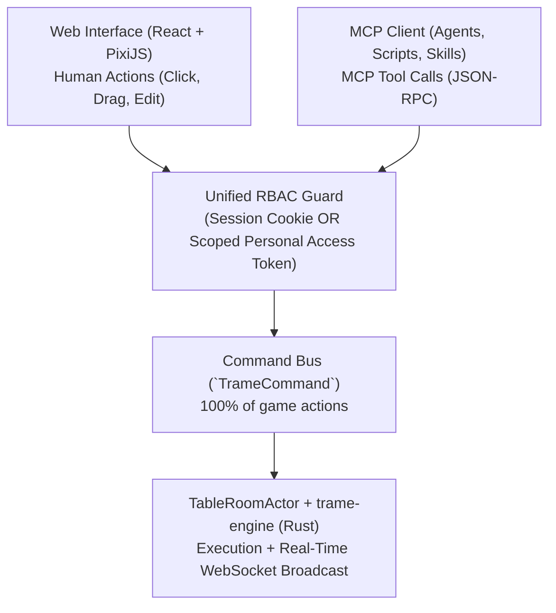

# TRAME — Phase 3: Native MCP Server, Wiki Notes System & External Skills

This document specifies the architecture of the **Native MCP Server** in **TRAME**, the **Notes & Lore System (Wiki style)**, real-time collaborative editing conflict resolution, and the principle of **100% UI $\leftrightarrow$ MCP Parity**.

---

## 1. Architectural Principle: 100% Parity Between UI and MCP Server

In TRAME, **every action a human can perform in the web interface (DM or Player) can also be performed by an agent via the MCP server**, enforcing the exact same validation rules (`trame-engine`) and role-based access control (RBAC).

Both the Web UI and the MCP server emit the exact same **Typed Domain Commands (`TrameCommand`)** to the Rust server.

---

## 2. "Dry-Run / Staging Proposal" Mode & Atomic MCP Batching (Q7)

When an AI agent executes heavy or creative operations via MCP (e.g., *"Generate an ambush with 6 monsters and modify the room walls"* or *"Rewrite the session notes"*), the DM can choose between two execution modes:

1. **Direct Execution (`commit: true` by default) + 1-Click Undo**:
   * The `mcp.execute_batch` MCP tool groups multiple commands (`spawn_tokens`, `set_lights`, `set_walls`) into a **single history transaction (`BatchUndoEntry`)**.
   * A subtle banner appears on the DM's screen: `🤖 MCP Agent: "Goblin Ambush created (8 actions)" [Undo Batch]`. A single click on *Undo* reverts the entire MCP batch.
2. **Preview / Approval Mode (`dry_run: true` or `mode: "propose"`)**:
   * The agent submits a batch of changes in `propose` mode.
   * On the DM's Table, the new tokens, walls, or lights proposed by the AI appear as a **bluish ghost overlay (invisible to players)** with **`[✓ Apply to Table]`** and **`[✕ Reject]`** buttons.

---

## 3. Notes & Lore System: Structured Wiki, Cross-Links & Handouts

### 3.1 The 3 Visibility Scopes (`Visibility Scopes`)

1. **`PRIVATE` (Personal Notebook)**: Strictly private to its author.
2. **`PARTY` (Shared Party Wiki & Journal)**: Collaborative notebook shared across the entire table (*Session Log*, *Active Quests*, *Discovered Clues*, *Known NPCs*).
3. **`DM_ONLY` (Campaign Bible & DM Secrets)**:
   * Directory tree restricted to the DM, supporting secret `:::dm` blocks and revealable `:::handout[title="..." revealed=false]` blocks inside any `PARTY` note.
   * **Strict Server-Side Filtering**: Whenever `revealed=false`, the Rust server strips all `:::dm` and `:::handout` blocks from the Markdown payload before transmitting it to players.

### 3.2 Real-Time Collaborative Editing & Conflict-Free External / MCP Synchronization (Q8)

To prevent a player editing the *Party Journal* from overwriting another player's edits, or an external MCP synchronization from overwriting a note modified during a live session:

1. **Real-Time UI Editing (Yjs CRDT / `yrs` in Rust)**:
   * Notes opened simultaneously by multiple members use the **`yrs` Rust crate (official Rust port of Yjs)** on the server and Yjs in the client Markdown editor: live cursors of other players are visible in real time and no keystroke is ever lost.
2. **Optimistic External Synchronization (`ETag` + Markdown `3-Way Merge`)**:
   * Every note carries a monotonic revision number (`revision`) and a `content_sha256` hash.
   * When an MCP tool calls `notes.sync_batch` with `base_revision`, `trame-server` performs:
     * If the note has not changed in TRAME: direct update (*fast-forward*).
     * If the note was modified on both sides in different paragraphs: **automatic 3-way merge (`diffy::merge` in Rust)** while preserving `:::dm` blocks.
     * If the same paragraph was modified on both sides: saves a conflict version in the note's history without losing any data and alerts the DM.

### 3.3 Structured Session Event Log (`Session Event Stream` — Q17)

In addition to text chat, every active session records a **typed event stream (`session_events`)**:
* Each timestamped event contains: `event_type` (`combat_started`, `attack_rolled`, `creature_defeated`, `door_opened`, `handout_revealed`, `loot_acquired`, `chat_in_character`), the involved actors, and the location/map.
* **Dedicated MCP Resource (`campaign://{id}/sessions/{num}/timeline`)**: Allows an AI skill (`/session-recap` or `/journal-sync`) to read the entire objective timeline of the evening in a fraction of a second to automatically draft the narrative session chronicle and update NPC states in the Wiki.

---

## 4. Comprehensive Catalog of MCP Capabilities (100% of TRAME Actions)

### 4.1 Table, Movement, Combat & AoE Tools (`table.*` & `combat.*`)

| MCP Tool (`Tool`) | Primary Parameters | Authorized Role | Live Effect on the Table |
| :--- | :--- | :--- | :--- |
| `table.set_mode` | `mode: "exploration" \| "combat"`, `paused: bool` | DM | Switches between Exploration mode and Turn-Based mode, or pauses the table. |
| `table.set_lighting_preset` | `preset: "day" \| "dusk" \| "moonlight" \| "dark"` | DM | Instantly changes the Day/Night cycle and global illumination of the map. |
| `table.move_token` | `token_id`, `path: [{x, y, z?}]`, `ignore_walls?: bool` | DM or Owner | Moves the token along the path (validates collisions, altitude, and speed, and updates vision). |
| `table.undo_last_action` | `action_id?` | DM | Undoes the last move/action (or MCP batch), refunds movement speed, and restores fog of war. |
| `table.interact_door` | `wall_id`, `state: "open" \| "closed" \| "locked" \| "secret"` | DM / Player ($\le 1$ cell) | Opens, closes, locks, or hides a door and recalculates lines of sight. |
| `table.place_aoe` | `shape`, `origin`, `dimensions`, `discretization_rule?`, `persistent: bool`, `effects` | DM or Player | Places a spell template (clipped by walls), returns hit targets, and applies terrain/light if persistent. |
| `table.resolve_aoe_save` | `aoe_id`, `ability: "DEX"`, `dc: 15`, `damage_formula: "8d6"`, `damage_type: "fire"` | DM or Caster | Rolls saving throws for targets and applies damage (calculating resistances/immunities). |
| `combat.start_or_end` | `active: bool`, `participants?: [token_id]` | DM | Starts or ends initiative tracking. |
| `combat.roll_initiative` | `token_ids: [...]` | DM or Player | Computes and rolls initiative according to the system rules. |
| `combat.update_turn_economy` | `token_id`, `movement_left?`, `action?`, `bonus_action?`, `reaction?` | DM or Active Player | Spends or refunds an Action, Bonus Action, Reaction, or movement. |
| `combat.next_turn` | — | DM or Active Player | Advances to the next combatant, decrements effect/condition durations, and resets the turn budget. |

### 4.2 Map Architecture, Walls, Lights, Audio & Fog Tools (`maps.*`)

| MCP Tool (`Tool`) | Description | Role |
| :--- | :--- | :--- |
| `maps.create` / `maps.configure_grid` | Creates a map, configures the grid (square/hex, px size, `5 ft` scale), and activates it at the table. | DM |
| `maps.import_uvtt` / `maps.export_uvtt` | Imports or exports a standard `.uvtt` / `.dd2vtt` file along with its image, walls, doors, and light sources. | DM |
| `maps.set_walls` | Batch-adds, updates, or deletes segments (`solid`, `window`, `terrain`, `door`, `curtain`), their `top_z` height, `indoor` polygons, roofs (`overhead`), and teleporters/stairs (`teleporters`). | DM |
| `maps.set_lights` / `maps.set_audio_sources` | Places and configures dynamic light sources and spatialized audio emitters on the map. | DM |
| `maps.edit_fog` | Reveals or hides manual fog regions, or resets exploration memory. | DM |
| `maps.spawn_tokens` | Spawns one or more tokens onto the map from an actor or the SRD bestiary. | DM |

### 4.3 Character, Companion, Container & Compendium Tools (`actors.*` & `compendium.*`)

| MCP Tool (`Tool`) | Description | Role |
| :--- | :--- | :--- |
| `systems.list` / `systems.register_pack` | Lists systems or hot-installs/updates a declarative `GameSystemPack` (YAML/JSON). | Admin / DM |
| `compendium.search` / `compendium.upsert_entry` | Searches the SRD or creates/updates a Homebrew monster, spell, feat, or item in the campaign or instance. | DM / Player (read) |
| `actors.create` / `actors.update_sheet` | Creates or updates a PC, NPC, Familiar/Summon (`companion`), or Loot Chest (`container`). | DM / Player (own PC) |
| `actors.transform_shape` | Applies or removes a temporary transformation (*Wild Shape*, *Polymorph*) based on a bestiary creature. | DM / Player (own PC) |
| `actors.manage_inventory` | Adds, equips, attunes (`attune`), identifies, or transfers an item between a character and a party chest. | DM / Player (own PC) |
| `actors.roll_action` | Executes an ability check, skill check, saving throw, weapon attack, or spell roll from the sheet. | DM / Player (own PC) |
