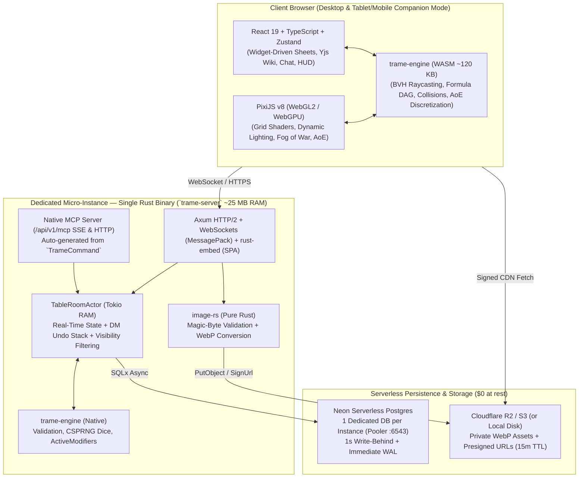

# TRAME — Tabletop Rules, Actors, Maps & Encounters

> **Clean-Slate Architecture & Dedicated Hosting**  
> Target License: **Apache-2.0** | Target Repository: `Hartorn-Inc/trame`

This directory contains the complete architectural and functional specifications for **TRAME**, refined through detailed design and stress-testing sessions (`/grill-with-specs` — 25 validated architectural decisions).

---

## Specification Document Index (`V2/`)

| File | Scope Covered |
| :--- | :--- |
| [**`01-TABLE-SPEC.md`**](./01-TABLE-SPEC.md) | **The Virtual Table (PixiJS v8 GPU Core + WASM Geometry)**: Exploration vs. Turn-Based Combat Modes, Multi-Tile Footprints ($0.5 \times 0.5$ to $4 \times 4$) & Squeezing, 3D Elevation (Z-axis & Flight), Interrupts & Opportunity Reactions, Walls/Doors/Windows/Roofs, Day/Night Cycle & Indoor/Outdoor Zoning, Teleporters & Simultaneous Multi-Map Support, Vision Sensors (`Darkvision`, `See Invisibility`, `Truesight`, `Ethereal`), 3 Fog of War Layers, AoE Templates with 4 Discretization Rules and Persistent Zones, Freehand Drawings & Spatialized Audio, DM Override & Undo/Redo Tools. |
| [**`02-GAME-ENGINE-AND-DND5E.md`**](./02-GAME-ENGINE-AND-DND5E.md) | **Generic Game System Engine (`GameSystemPack`) & Built-in D&D 5e Pack**: Declarative YAML/JSON Schema (`character`, `npc`, `companion/summon` with *Wild Shape*, `container/group_stash`), Derived Formula DAG, Deterministic 5-Phase `ActiveModifiers` Pipeline (Items, Feats, Features, Conditions), Turn-Based Duration Management & Automatic Concentration, Damage Types/Resistances/Immunities & 3 Combat Transparency Modes (Campaign Setting), Homebrew Overlay & SRD Compendium, Library of ~15 TTRPG Widgets & Character Builder/Level-Up Wizard. |
| [**`03-MCP-AND-NOTES-SPEC.md`**](./03-MCP-AND-NOTES-SPEC.md) | **Native MCP Server, Wiki Notes System & External Skills**: 100% UI $\leftrightarrow$ MCP Parity via the `TrameCommand` Bus, *Dry-Run / Staging Proposal* Mode and 1-Click Undoable Atomic Batching, 3-Tier Markdown Wiki (`PRIVATE`, `PARTY`, `DM_ONLY`) with Secret `:::dm` Blocks and Revealable `:::handout` Blocks, Real-Time Collaborative CRDT Editing (`yrs` / Yjs) + 3-Way Merge (`diffy`) for Bidirectional Synchronization, Structured Session Event Log (`Session Event Stream`). |
| [**`04-RUNTIME-AND-DEDICATED-HOSTING.md`**](./04-RUNTIME-AND-DEDICATED-HOSTING.md) | **Real-Time Architecture (Command Handler, In-Memory Actors) & Dedicated Hosting**: `CommandHandler` Pattern + `ReversiblePatch` (DM Undo/Redo), In-Memory `TableRoomActor` with Dual Persistence (*1s Write-Behind* + *Immediate Commit WAL*), Server-Side Cryptographic Dice Generator (`ChaCha20Rng`), R2/S3 Image Security via Presigned URLs and Pure-Rust WebP Conversion (`image-rs`), Portable `.trame` Archive, On-Demand Dedicated Hosting Model (Cloud Run + Neon Postgres + Cloudflare R2 at $0 idle cost via `Idle-Lease`, or `e2-micro` VM), Mobile/Tablet Companion Mode & Accessibility. |

---

## Selected Technology Stack Summary

---

## Planned EPURE Governance for `Hartorn-Inc/trame` (Q24)

When initializing the `Hartorn-Inc/trame` repository with `/setup-repo`, the roster of **12 specialized reviewer agents** (`.cursor/agents/*.md`) will be configured to cover the full Rust + WASM + PixiJS + MCP architecture:

### 5 Domain & Stack Specialists (`paths`-scoped)
1. **`engine-wasm-reviewer`** (`crates/trame-engine/**`): Rust/WASM determinism, zero panics or unnecessary allocations at 60 FPS, accuracy of spatial BVH, 2D/3D raycasting, and the 5-phase rules pipeline.
2. **`table-gpu-reviewer`** (`packages/web/src/table/**`): PixiJS v8 shaders (WebGL2/WebGPU), GPU memory management (fog/light FBOs), 60 FPS smoothness, AoE discretization rules, and animation synchronization.
3. **`domain-server-reviewer`** (`crates/trame-server/**`): `CommandHandler` pattern, `TableRoomActor`, zero-loss WAL/Write-Behind guarantees, MCP security (`Scoped PAT`), `image-rs` conversion, and WebSocket `Idle-Lease`.
4. **`game-systems-reviewer`** (`packages/game-systems/**`, `crates/trame-engine/src/systems/**`): `GameSystemPack` schema compliance, D&D 5e rules accuracy (SRD 5.1 CC-BY-4.0), sheet widgets, and feat/effect stacking.
5. **`infra-reviewer`** (`deploy/**`, `.github/**`, `Cargo.toml`, `Dockerfile`): `distroless` Docker image, Cloud Run / `e2-micro` configuration, Neon Postgres, Cloudflare R2, and CI/CD security.

### 7 Always-On Cross-Cutting Reviewers
6. **`architecture-reviewer`**: Enforces 100% UI $\leftrightarrow$ MCP parity (`TrameCommand`) and zero duplication between client and server.
7. **`security-reviewer`**: Per-token Zero-Trust network filtering (vision anti-cheat, `INVISIBLE`/`ETHEREAL`/`HIDDEN_BY_DM` channels), server-side `:::dm` block stripping, CSPRNG dice, and R2 presigned URLs.
8. **`spec-parity-reviewer`**: 1-to-1 compliance with the 4 reference specifications (`01` through `04`).
9. **`standards-reviewer`**: Idiomatic Rust quality (`clippy --all-targets -- -D warnings`), strict TypeScript (zero `any`), and parameterized tests.
10. **`frontend-reviewer`**: React 19 architecture, Zustand / TanStack Query / Yjs CRDT state separation, and Mobile Companion Mode.
11. **`accessibility-reviewer`**: WCAG 2.2 AA compliance, keyboard navigation, theme contrast (`-ink`), and colorblind mode on the Table.
12. **`design-reviewer` & `user-advocate`**: User experience across the 4 canonical personas (*DM*, *Player*, *Spectator*, *Instance Operator*) in both Exploration and Turn-Based modes.
