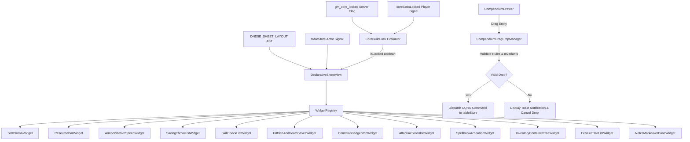

# Spec 78 - Full 12-Widget Declarative Character Sheet Preact Binding & Compendium Drag-and-Drop Drawer

## 1. Executive Summary

This specification defines the complete binding between the declarative character sheet layout `DND5E_SHEET_LAYOUT` (`@trame/game-system-dnd5e`), the 12 widget Preact component implementations, and the searchable `CompendiumDrawer` in `@trame/web`. It resolves Issue #78 by replacing the legacy hardcoded HUD sheet in `HudDrawers.tsx` with `DeclarativeSheetView` and enabling seamless, rule-validated drag-and-drop of items, containers, spells, and features via `CompendiumDragDropManager`.

## 2. Architectural Overview

`DeclarativeSheetView` provides a unified Preact character sheet view rendered both inside the Live Table drawer (`HudDrawers.tsx`) and in the standalone `CampaignWorkspace`. The component accepts an AST layout definition, inspects registered widget renderers in `WidgetRegistry`, and maps actor state signals into granular widget props.



## 3. Formal System Invariants (ASD-STE100 Rules)

- `INV-01`: IF `gm_core_locked` equals `true`, THEN `DeclarativeSheetView` MUST evaluate `isLocked` to `true`. IF `gm_core_locked` equals `true`, THEN `CoreBuildLockToggle` MUST set the padlock toggle button to disabled.
- `INV-02`: WHEN `isLocked` equals `true`, THEN clicking any `AbilityScore`, saving throw, skill, attack, or spell MUST dispatch a `RollDice` command. WHEN `isLocked` equals `true`, THEN the widget MUST NOT render editable numeric steppers or text inputs for build scores.
- `INV-03`: WHEN `isLocked` equals `false`, THEN `DeclarativeSheetView` MUST render editable numeric steppers for `AbilityScore` base values. WHEN `isLocked` equals `false`, THEN `DeclarativeSheetView` MUST render cyclic selectors for `ProficiencyRank`.
- `INV-04`: `DeclarativeSheetView` MUST keep active play state controls editable at all times by the actor owner and GM. Active play state controls include current HP, temporary HP, `DeathSaveCounters`, spell slots, ammunition quantity, currency, inventory items, and notes.
- `INV-05`: WHEN a container is dropped into another container, THEN `CompendiumDragDropManager` MUST verify that the destination container is not identical to the source container. WHEN a container is dropped into another container, THEN `CompendiumDragDropManager` MUST verify that the destination container is not an existing descendant of the source container. IF a container drop creates a circular reference, THEN `CompendiumDragDropManager` MUST reject the drop and MUST display an error toast notification.
- `INV-06`: IF `attunedItems` count equals 3, THEN `CompendiumDragDropManager` MUST reject an attunement attempt for a fourth item with a warning notification.
- `INV-07`: `InventoryContainerTree` MUST calculate the total carried weight as the sum of direct item weights plus nested container effective weights. IF a container has `contentWeightMultiplier` equal to 0, THEN `InventoryContainerTree` MUST calculate the container weight as container tare weight plus 0 pounds.
- `INV-08`: `InventoryContainerTree` MUST calculate encumbrance thresholds deterministically: regular encumbrance threshold equals Strength score multiplied by 5 pounds, heavy encumbrance threshold equals Strength score multiplied by 10 pounds, and maximum carrying capacity equals Strength score multiplied by 15 pounds.
- `INV-09`: WHEN the user clicks `[ Cast / Project AoE ]` on a spell with an AoE template in the Live Table view, THEN `SpellbookAccordion` MUST arm the `TableCanvas` AoE projection tool with the spell geometric parameters. WHEN `SpellbookAccordion` arms the `TableCanvas` AoE projection tool, THEN the system MUST close the sheet drawer. IF `TableCanvas` is not mounted, THEN `SpellbookAccordion` MUST display a warning toast notification and MUST keep the sheet drawer open.
- `INV-10`: WHEN actor HP equals 0 and the user triggers a `DeathSavingThrow`: IF the d20 roll result is 10 or greater, THEN `HitDiceAndDeathSaves` MUST add 1 success. IF the d20 roll result is between 2 and 9, THEN `HitDiceAndDeathSaves` MUST add 1 failure. IF the d20 roll result is a natural 1, THEN `HitDiceAndDeathSaves` MUST add 2 failures. IF the d20 roll result is a natural 20, THEN `HitDiceAndDeathSaves` MUST restore 1 current HP and MUST reset `DeathSaveCounters` to 0. IF `DeathSaveCounters` reaches 3 successes, THEN the system MUST set actor condition to stable. IF `DeathSaveCounters` reaches 3 failures, THEN the system MUST set actor condition to deceased.
- `INV-11`: `SkillCheckList` MUST sort all skill rows deterministically in alphabetical order by localized skill name.
- `INV-12`: WHEN the user modifies text in `NotesMarkdownPane`, THEN `NotesMarkdownPane` MUST wait exactly 500 milliseconds of inactivity before dispatching the auto-save command.
- `INV-13`: WHEN the user triggers an attack with a defined `ammunitionItemId`, THEN `AttackActionTable` MUST dispatch an `UpdateActorField` command that decrements the referenced item quantity by 1. IF the referenced item quantity equals 0, THEN `AttackActionTable` MUST disable the attack trigger and MUST display a depleted ammunition badge.

## 4. The 12 Declarative Widgets Specification

### 4.1 StatBlock6Widget (`StatBlock6`)
- Description: Displays the six core ability scores: STR, DEX, CON, INT, WIS, CHA.
- `boundValues`: `{ scores: Record<'str' | 'dex' | 'con' | 'int' | 'wis' | 'cha', number> }`
- `derivedDAG`: `{ modifiers: Record<'str' | 'dex' | 'con' | 'int' | 'wis' | 'cha', number>, passivePerception: number }`
- Behavior:
  - IF `isLocked === true`, clicking any ability block dispatches `RollDice` with `1d20 + modifier`.
  - IF `isLocked === false`, each block renders numeric stepper controls (`-` and `+`) modifying the base score.

### 4.2 ResourceBarWidget (`ResourceBar`)
- Description: Displays current HP, maximum HP, temporary HP, and hit points gauge.
- `boundValues`: `{ hpCurrent: number, hpMax: number, hpTemp: number }`
- `derivedDAG`: `{ effectiveMaxHp: number, bloodiedThreshold: number, isBloodied: boolean }`
- Behavior: Always editable by the owner or GM. Direct numeric inputs allow updating current and temporary HP. In edit mode (`isLocked === false`), maximum HP is also editable.

### 4.3 ArmorInitiativeSpeedWidget (`ArmorInitiativeSpeed`)
- Description: Displays Armor Class (AC), Initiative bonus, and Movement Speed in feet.
- `boundValues`: `{ baseAc: number, baseSpeedFeet: number }`
- `derivedDAG`: `{ effectiveAc: number, initiativeBonus: number, effectiveSpeedFeet: number, acFormulaLabel: string }`
- Behavior: AC and Speed display active values computed by `derivedDAG`. Clicking Initiative in roll mode dispatches `RollDice` with `1d20 + initiativeBonus`.

### 4.4 SavingThrowListWidget (`SavingThrowList`)
- Description: Lists saving throws for all six abilities.
- `boundValues`: `{ saves: Record<'str' | 'dex' | 'con' | 'int' | 'wis' | 'cha', { proficient: boolean, bonusOverride?: number } }`
- `derivedDAG`: `{ saveBonuses: Record<'str' | 'dex' | 'con' | 'int' | 'wis' | 'cha', number>, proficiencyBonus: number }`
- Behavior:
  - IF `isLocked === true`, clicking a save row dispatches `RollDice` with `1d20 + saveBonus`.
  - IF `isLocked === false`, clicking the proficiency indicator cycles proficiency state on and off.

### 4.5 SkillCheckListWidget (`SkillCheckList`)
- Description: Displays all 18 standard D&D 5e skills.
- `boundValues`: `{ skills: Record<string, { rank: 0 | 1 | 2, bonusOverride?: number }> }`
- `derivedDAG`: `{ skillBonuses: Record<string, number>, passiveScores: Record<string, number> }`
- Deterministic Sort Order: Rows are deterministically sorted in alphabetical order by localized skill name.
- Behavior:
  - IF `isLocked === true`, clicking a skill row dispatches `RollDice` with `1d20 + skillBonus`.
  - IF `isLocked === false`, clicking the proficiency circle cycles `ProficiencyRank` (`0 -> 1 -> 2 -> 0`).

### 4.6 HitDiceAndDeathSavesWidget (`HitDiceAndDeathSaves`)
- Description: Tracks hit dice spent/total and death saving throw successes/failures.
- `boundValues`: `{ hitDice: { current: number, max: number, dieType: string }, deathSaves: { successes: number, failures: number } }`
- `derivedDAG`: `{ deathSaveStatus: 'unconscious' | 'stable' | 'deceased' | 'active', canRollDeathSave: boolean }`
- Behavior: When actor HP equals 0, the component renders `DeathSavingThrow` tracking with 3 success pips and 3 failure pips, alongside an authoritative button labeled `[ Roll DeathSavingThrow ]`. Roll outcomes evaluate according to `INV-10`.

### 4.7 ConditionBadgeStripWidget (`ConditionBadgeStrip`)
- Description: Displays active condition badges (e.g., Blinded, Charmed, Exhaustion).
- `boundValues`: `{ activeConditions: string[] }`
- `derivedDAG`: `{ conditionEffects: Record<string, { label: string, severity: 'info' | 'warning' | 'danger' }>, exhaustionLevel: number }`
- Behavior: Badges are removable via close buttons for owner/GM. Clicking an empty slot opens the condition selection popover.

### 4.8 AttackActionTableWidget (`AttackActionTable`)
- Description: Renders attacks and weapon actions with ammunition tracking.
- `boundValues`: `{ attacks: Array<{ id: string, name: string, range: string, attackType: 'melee' | 'ranged' | 'spell', bonus: number, damage: string, damageType: string, ammunitionItemId?: string }> }`
- `derivedDAG`: `{ attackCalculations: Record<string, { effectiveToHit: number, effectiveDamage: string, hasAmmunition: boolean }> }`
- Concrete Ammunition Linkage Schema: When `ammunitionItemId` is present, the attack references `actor.system.inventory[ammunitionItemId]`. Rolling the attack dispatches an `UpdateActorField` command decrementing `inventory[ammunitionItemId].quantity` by 1 according to `INV-13`.

### 4.9 SpellbookAccordionWidget (`SpellbookAccordion`)
- Description: Renders spells grouped by spell level (Cantrips, Level 1 through 9, and Pact Magic) and tracks spell slot pips.
- `boundValues`: `{ spellSlots: Record<number, { current: number, max: number }>, pactMagic?: { current: number, max: number, level: number }, spells: Array<{ id: string, name: string, level: number, school: string, castingTime: string, range: string, components: string, duration: string, aoeTemplate?: { shape: 'cone' | 'circle' | 'line' | 'square', radiusFeet: number } }> }`
- `derivedDAG`: `{ spellSaveDc: number, spellAttackBonus: number, preparedCount: number, maxPreparedCount: number }`
- Behavior: Slot pips are toggled directly. Clicking `[ Cast / Project AoE ]` executes according to `INV-09`.

### 4.10 InventoryContainerTreeWidget (`InventoryContainerTree`)
- Description: Displays currencies (`cp, sp, ep, gp, pp`), item tree with nested containers, attunement slots, and encumbrance bar.
- `boundValues`: `{ currency: { cp: number, sp: number, ep: number, gp: number, pp: number }, items: Record<string, { id: string, name: string, quantity: number, weightPounds: number, containerId?: string, isContainer?: boolean, contentWeightMultiplier?: number, isAttuned?: boolean, requiresAttunement?: boolean }> }`
- `derivedDAG`: `{ totalCarriedWeight: number, encumbranceLevel: 'unencumbered' | 'encumbered' | 'heavily_encumbered' | 'overburdened', maxCarryPounds: number, attunedCount: number }`
- Validation: Enforces `INV-05` (cycle detection), `INV-06` (attunement cap of 3), `INV-07` (tare and zero-multiplier weight for *Bag of Holding*), and `INV-08` (Strength-based encumbrance thresholds).

### 4.11 FeatureTraitListWidget (`FeatureTraitList`)
- Description: Lists racial traits, class features, feats, and passive abilities.
- `boundValues`: `{ features: Array<{ id: string, name: string, source: 'race' | 'class' | 'feat' | 'other', summary: string, description: string }> }`
- `derivedDAG`: `{ groupedFeatures: Record<string, Array<{ id: string, name: string, summary: string }>> }`
- Behavior: Items are expandable for full text and searchable via filter input.

### 4.12 NotesMarkdownPaneWidget (`NotesMarkdownPane`)
- Description: Markdown text editor with tabbed Edit/Preview modes for backstory, campaign notes, and inventory records.
- `boundValues`: `{ markdownContent: string }`
- `derivedDAG`: `{ wordCount: number, lastSavedTimestamp: number }`
- Behavior: The edit view provides a monospaced textarea with an auto-save timer debounced to exactly 500 milliseconds according to `INV-12`.

## 5. Compendium Drawer & CompendiumDragDropManager

### 5.1 CompendiumDrawer UI
- Multi-source search across `CAMPAIGN_HOMEBREW > INSTANCE_LIBRARY > SYSTEM_SRD`.
- Dual-language search matching both English and French titles and keywords.
- Categorized tabs: Items, Spells, Feats, Monsters.

### 5.2 Stateless CompendiumDragDropManager
- Emits standard drag events: `dataTransfer.setData('application/json', JSON.stringify({ type, sourceId, entityData }))`.
- Drop targets mounted on `InventoryContainerTree` (items, containers), `SpellbookAccordion` (spells), and `FeatureTraitList` (feats).
- Direct CQRS command dispatch: Dispatches `UpdateActorField` or `UpsertActor` immediately without staging queues or secondary client caches.

### 5.3 Cycle Prevention Algorithm
```typescript
function wouldCreateCycle(items: Record<string, InventoryItem>, sourceId: string, destContainerId: string): boolean {
  if (sourceId === destContainerId) return true;
  let current = items[destContainerId];
  while (current && current.containerId) {
    if (current.containerId === sourceId) return true;
    current = items[current.containerId];
  }
  return false;
}
```

## 6. Target Files

- `packages/web/src/sheet/DeclarativeSheetView.tsx`
- `packages/web/src/sheet/WidgetRegistry.ts`
- `packages/web/src/sheet/widgets/StatBlock6Widget.tsx`
- `packages/web/src/sheet/widgets/ResourceBarWidget.tsx`
- `packages/web/src/sheet/widgets/ArmorInitiativeSpeedWidget.tsx`
- `packages/web/src/sheet/widgets/SavingThrowListWidget.tsx`
- `packages/web/src/sheet/widgets/SkillCheckListWidget.tsx`
- `packages/web/src/sheet/widgets/HitDiceAndDeathSavesWidget.tsx`
- `packages/web/src/sheet/widgets/ConditionBadgeStripWidget.tsx`
- `packages/web/src/sheet/widgets/AttackActionTableWidget.tsx`
- `packages/web/src/sheet/widgets/SpellbookAccordionWidget.tsx`
- `packages/web/src/sheet/widgets/InventoryContainerTreeWidget.tsx`
- `packages/web/src/sheet/widgets/FeatureTraitListWidget.tsx`
- `packages/web/src/sheet/widgets/NotesMarkdownPaneWidget.tsx`
- `packages/web/src/compendium/CompendiumDrawer.tsx`
- `packages/web/src/compendium/CompendiumDragDropManager.ts`
- `packages/web/src/hud/HudDrawers.tsx`
- `packages/web/tests/sheet/DeclarativeSheetView.test.tsx`
- `packages/web/tests/sheet/widgets/Widgets12.test.tsx`
- `packages/web/tests/compendium/CompendiumDragDropManager.test.ts`